# 組件詳細說明

## 🏗️ 四層架構組件

MCP Feedback Enhanced 採用清晰的四層架構設計，每層負責特定的功能領域。本文檔詳細說明各層組件的實現細節、職責分工和交互機制。

### 架構設計原則

- **單一職責**: 每個組件專注於特定功能領域
- **低耦合**: 層間通過明確的接口通信
- **高內聚**: 相關功能集中在同一層內
- **可擴展**: 支援新功能的無縫集成
- **可測試**: 每層都可獨立進行單元測試

### 詳細組件關係圖

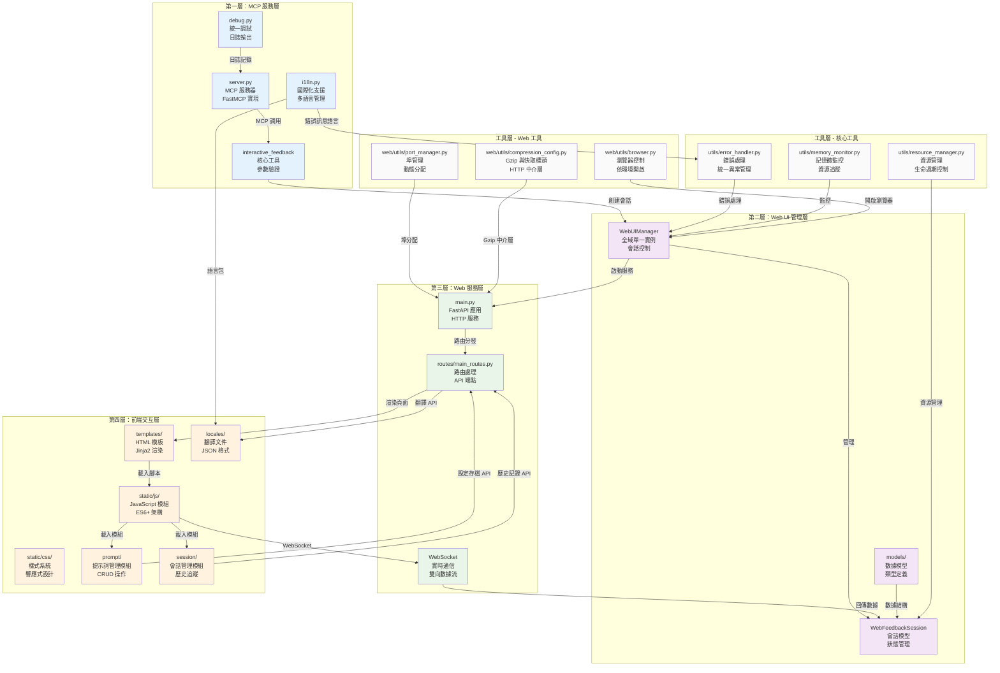

## 🔧 第一層：MCP 服務層

### server.py - MCP 服務器核心

**架構實現**：
```python
# 基於 FastMCP 的服務器實現
SERVER_NAME = "互動式回饋收集 MCP"
mcp: Any = FastMCP(SERVER_NAME)

@mcp.tool()
async def interactive_feedback(
    project_directory: Annotated[str, Field(description="專案目錄路徑")] = ".",
    summary: Annotated[str, Field(description="AI 工作完成的摘要說明")] = "我已完成了您請求的任務。",
    timeout: Annotated[int, Field(description="等待使用者回饋的逾時時間（秒）。有效範圍 60–86400；超出範圍會由伺服器端鉗制，因為使用者需要實際可用的回饋時間。")] = DEFAULT_FEEDBACK_TIMEOUT,  # 600
) -> list[TextContent | ImageContent]:
    # 1. 環境偵測（is_remote_environment／is_wsl_environment，只寫 debug log）
    # 2. 專案目錄不存在時改用目前工作目錄；timeout 經 resolve_feedback_timeout() 鉗制
    # 3. launch_web_feedback_ui()：建立會話、啟動 Web 服務、開啟介面並等待回饋
    # 4. save_feedback_to_file() 把回饋存成臨時 JSON
    # 5. 以 create_feedback_text() 與 process_images() 組成回傳內容
```

**主要職責**：
- **MCP 協議實現**: 基於 FastMCP 框架的標準實現
- **工具註冊**: 註冊 `interactive_feedback` 和 `get_system_info` 工具
- **環境偵測**: `is_remote_environment()` 與 `is_wsl_environment()` 的結果只寫進 debug log 與 `get_system_info` 的回傳，不改變流程；WSL 判斷另用於選擇瀏覽器開啟方式（見 `web/utils/browser.py`）
- **生命週期管理**: 控制 Web UI 的啟動、運行和清理
- **接口層**: 作為 AI 助手與系統的主要通信接口

**核心特性**：
- 異步處理提升性能
- 完整的錯誤處理和日誌記錄
- 參數類型驗證和文檔生成

### interactive_feedback 工具

**工具執行流程**：
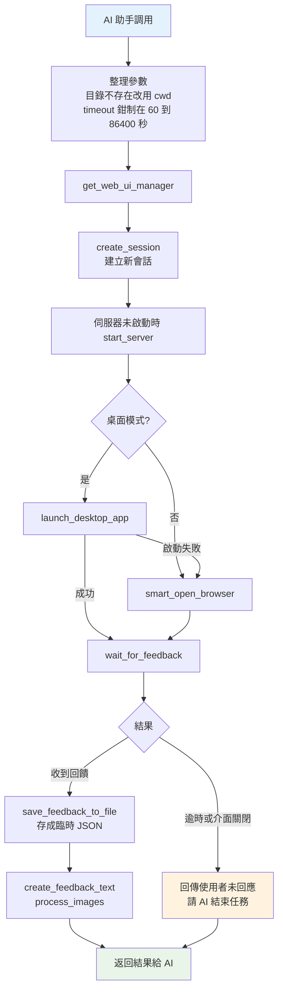

**參數說明**：
- `project_directory`: 專案目錄路徑，顯示在介面上；路徑不存在時改用伺服器目前工作目錄
- `summary`: AI 工作摘要，顯示給用戶確認
- `timeout`: 等待超時時間，預設 600 秒（10 分鐘），伺服器端鉗制在 60–86400 秒

**返回格式**：
```python
# 成功返回
[
    TextContent(type="text", text="=== 使用者回饋 ===\n..."),             # create_feedback_text()
    ImageContent(type="image", data="<base64>", mime_type="image/png"),  # process_images()，可選
]

# 使用者未回應（逾時或關閉介面）
[TextContent(type="text", text="使用者未回應（...）。請視為使用者已離開...")]  # no_response_text()

# 錯誤返回
[TextContent(type="text", text=ErrorHandler.format_user_error(e, include_technical=False))]
```

### i18n.py - 國際化支援

**多語言架構**：
```python
class I18nManager:
    def __init__(self):
        self._supported_languages = ["zh-CN", "zh-TW", "en"]
        self._fallback_language = "zh-TW"
        self._config_file = self._get_config_file_path()  # ~/.config/mcp-feedback-enhanced/language.json
        self._locales_dir = Path(__file__).parent / "web" / "locales"

    def t(self, key: str, **kwargs) -> str:
        """翻譯函數，支援巢狀鍵值與 str.format 參數替換；找不到時改查回退語言，再找不到回傳鍵本身"""

def get_i18n_manager() -> I18nManager: ...
```

**核心功能**：
- **三語支援**: 繁體中文、簡體中文、英文
- **語言偵測**: `MCP_LANGUAGE` > 介面儲存的 `language.json` > `LANG`、`LC_ALL` 等環境變數 > 系統 locale > `zh-TW`
- **使用範圍**: 後端只有 `ErrorHandler` 用它決定錯誤訊息語言；Web 介面文字由前端 `i18n.js` 透過 `GET /api/translations` 載入同一批 `translation.json`，切換語言不需重啟
- **巢狀翻譯**: 支援 `buttons.submit` 格式的鍵值
- **參數替換**: 支援 `{name}` 格式的動態內容
- **回退機制**: 翻譯缺失時改用回退語言 `zh-TW`，仍找不到就回傳鍵本身

**翻譯文件結構**：
```json
{
    "app": {
        "title": "MCP Feedback Enhanced",
        "subtitle": "AI 輔助開發回饋收集器"
    },
    "buttons": {
        "submit": "✅ 提交回饋",
        "cancel": "❌ 取消"
    }
}
```

### debug.py - 統一調試系統

**調試功能**：
- **條件輸出**: 只在 `MCP_DEBUG` 為 `true`、`1`、`yes`、`on` 時輸出
- **分類日誌**: 不同模組使用不同前綴
- **安全輸出**: 輸出到 stderr 避免干擾 MCP 通信
- **編碼處理**: stderr 無法編碼時改以 ASCII 替代字元輸出，stderr 不存在時靜默略過
- **使用者提示**: `user_notice()` 不受 `MCP_DEBUG` 控制，用於「請手動開啟網址」這類必須讓使用者看到的訊息

**使用方式**：
```python
from .debug import server_debug_log as debug_log
debug_log("伺服器啟動完成")  # [SERVER] 伺服器啟動完成
```

## 🎛️ 第二層：Web UI 管理層

### WebUIManager - 核心管理器

**全域單一實例**（模組層級變數，不是 `__new__` 單例）：
```python
class WebUIManager:
    def __init__(self, host: str = "127.0.0.1", port: int | None = None):
        # host：MCP_WEB_HOST > 參數；port：參數 > MCP_WEB_PORT > 8765，再經 PortManager 找可用埠
        self.app = FastAPI(title="MCP Feedback Enhanced")
        self.current_session: WebFeedbackSession | None = None
        self.sessions: dict[str, WebFeedbackSession] = {}  # 保留用於向後兼容
        self.server_thread: threading.Thread | None = None
        self.desktop_app_instance: Any = None

_web_ui_manager: WebUIManager | None = None

def get_web_ui_manager() -> WebUIManager:
    global _web_ui_manager
    if _web_ui_manager is None:
        _web_ui_manager = WebUIManager()
    return _web_ui_manager
```

**核心職責**：
- **會話管理**: 單一活躍會話的創建、更新、清理
- **服務器控制**: 在背景執行緒啟動 uvicorn（`start_server`），以及停止服務（`stop`）
- **瀏覽器控制**: 智能開啟瀏覽器，避免重複視窗
- **資源管理**: 自動清理過期資源和錯誤處理
- **活躍標籤頁偵測**: `_check_active_tabs()` 以目前會話 WebSocket 的心跳或 ping 判斷是否已有開著的頁面

**關鍵方法**：
```python
def create_session(self, project_directory: str, summary: str) -> str:
    """建立新會話並設為目前會話；舊會話若已提交則推進到 COMPLETED，WebSocket 連線轉移給新會話"""

def start_server(self):
    """在 daemon 執行緒以 uvicorn 啟動，埠被占用時換埠重試"""

async def smart_open_browser(self, url: str) -> bool:
    """有活躍標籤頁就送 session_updated 通知，否則呼叫 open_browser()"""

def open_browser(self, url: str) -> bool:
    """呼叫 smart_browser_open()；開不了時用 user_notice() 在 stderr 印出網址"""

async def launch_desktop_app(self, url: str) -> bool:
    """桌面模式啟動桌面殼"""

def get_server_url(self) -> str:
    """回傳 http://{host}:{port}"""

def cleanup_expired_sessions(self) -> int: ...
def cleanup_sessions_by_memory_pressure(self, force: bool = False) -> int: ...
```

**瀏覽器開啟機制**：
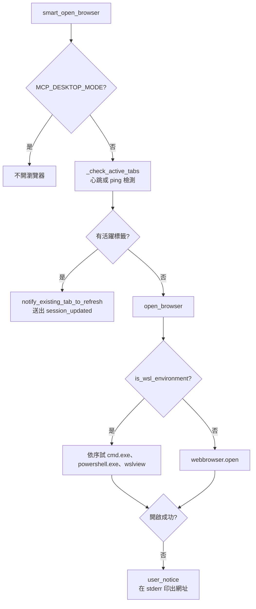

SSH 遠端沒有專門分支，不會建立 SSH 隧道；遠端主機開不了瀏覽器時只會印出網址。

### WebFeedbackSession - 會話模型

**會話狀態機**：
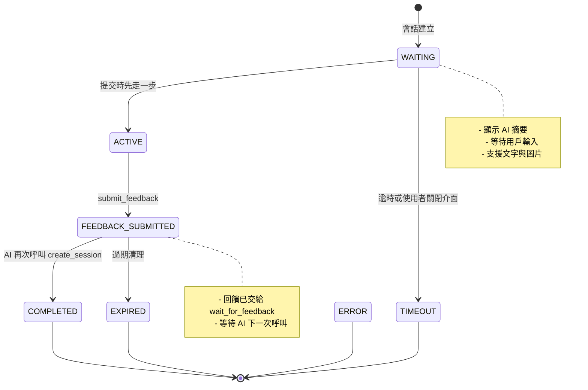

`next_step()` 只能單向推進（WAITING → ACTIVE → FEEDBACK_SUBMITTED → COMPLETED）；`TIMEOUT`、`EXPIRED`、`ERROR` 由清理流程依 `CleanupReason` 直接設定，`COMPLETED`、`ERROR`、`TIMEOUT`、`EXPIRED` 都是終態。

**會話數據結構**：
```python
class WebFeedbackSession:
    def __init__(self, session_id: str, project_directory: str, summary: str,
                 auto_cleanup_delay: int = 3600, max_idle_time: int = 1800):
        self.websocket: WebSocket | None = None
        self.feedback_result: str | None = None
        self.images: list[dict] = []
        self.settings: dict[str, Any] = {}
        self.feedback_completed = threading.Event()
        self.user_messages: list[dict] = []
        self.status = SessionStatus.WAITING
        self.created_at = time.time()
        self.last_activity = self.created_at
        self.last_heartbeat = None

    async def wait_for_feedback(self, timeout: int = 600) -> dict[str, Any]:
        """等待 feedback_completed；收到回饋回傳 interactive_feedback、images、settings，
        逾時或使用者關閉介面則清理資源並拋出 TimeoutError"""

    async def submit_feedback(self, feedback: str, images: list[dict[str, Any]],
                              settings: dict[str, Any] | None = None):
        """在鎖內原子寫入回饋並推進狀態；已收過回饋時忽略重複提交"""

    def next_step(self, message: str | None = None) -> bool:
        """單向推進狀態，終態回傳 False"""
```

AI 每次呼叫都由 `WebUIManager.create_session()` 建立新會話，不會更新既有會話。

**狀態枚舉**：
```python
class SessionStatus(Enum):
    WAITING = "waiting"                         # 等待中
    ACTIVE = "active"                           # 活躍狀態
    FEEDBACK_SUBMITTED = "feedback_submitted"   # 已提交反饋
    COMPLETED = "completed"                     # 已完成
    ERROR = "error"                             # 錯誤（終態）
    TIMEOUT = "timeout"                         # 超時（終態）
    EXPIRED = "expired"                         # 已過期（終態）
```

### models/ - 數據模型層

`web/models/__init__.py` 只匯出 `WebFeedbackSession`、`SessionStatus`、`CleanupReason`，都定義在 `feedback_session.py`；沒有獨立的回饋結果型別，`wait_for_feedback()` 直接回傳 dict，轉成 MCP 格式由 `server.py` 的 `create_feedback_text()` 與 `process_images()` 處理。

**CleanupReason 枚舉**：
```python
class CleanupReason(Enum):
    TIMEOUT = "timeout"                  # 超時清理
    EXPIRED = "expired"                  # 過期清理
    MEMORY_PRESSURE = "memory_pressure"  # 內存壓力清理
    MANUAL = "manual"                    # 手動清理
    ERROR = "error"                      # 錯誤清理
    SHUTDOWN = "shutdown"                # 系統關閉清理
```

**WebSocket 消息**：沒有獨立的模型類別，直接以 dict 經 `send_json()` 傳送，類型見下方 routes 段。

## 🌐 第三層：Web 服務層

### main.py - FastAPI 應用

沒有 `create_app()`；FastAPI 應用在 `WebUIManager.__init__` 中建立並設定：
```python
self.app = FastAPI(title="MCP Feedback Enhanced")
self._setup_compression_middleware()  # GZipMiddleware + 快取標頭中介層
self._setup_memory_monitoring()       # 註冊記憶體警告與會話清理回呼
...
self._init_basic_components()
#   ├─ _setup_static_files()  掛載 /static
#   ├─ _setup_templates()     Jinja2Templates(templates/)
#   └─ setup_routes(self)     routes/main_routes.py
```

**中介層與安全**：
- 沒有 CORS 中介層，也沒有全域 exception handler
- `setup_routes()` 註冊 `reject_cross_site_writes` 中介層：對 `/api/*` 的 GET/HEAD/OPTIONS 以外請求，`Origin` 不通過 `is_allowed_origin()` 回 403，`Content-Type` 不是 `application/json` 回 415
- `/ws` 端點同樣先驗 `Origin`，不符以 code 4003 關閉

**核心功能**：
- **HTTP 路由處理**: 頁面與 JSON API 端點
- **WebSocket 連接管理**: 實時雙向通信
- **靜態資源服務**: CSS、JS、圖片等資源
- **模板渲染**: Jinja2 模板引擎
- **伺服器執行**: `start_server()` 在 daemon 執行緒內以 uvicorn 啟動，同時執行 `_init_async_components()`
- **安全配置**: 跨站寫入與 WebSocket 來源檢查

### routes/main_routes.py - 路由處理

**路由架構圖**：
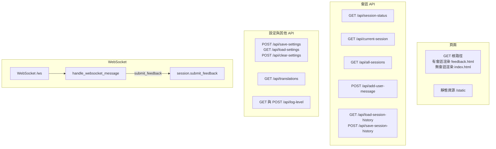

回饋（含圖片）只經 WebSocket 的 `submit_feedback` 訊息提交，沒有 HTTP 提交或圖片上傳端點；命令執行功能已在 v2.6.1 移除。

**頁面路由**：
```python
@manager.app.get("/", response_class=HTMLResponse)
async def index(request: Request):
    current_session = manager.get_current_session()
    if not current_session:
        return manager.templates.TemplateResponse(
            request, "index.html",
            context={"title": "MCP Feedback Enhanced", "has_session": False, "version": __version__},
        )
    return manager.templates.TemplateResponse(
        request, "feedback.html",
        context={
            "session_id": current_session.session_id,
            "project_directory": current_session.project_directory,
            "summary": current_session.summary,
            "title": "Interactive Feedback - 回饋收集",
            "version": __version__,
            "has_session": True,
            "layout_mode": load_user_layout_settings(),
        },
    )
```

**WebSocket 訊息類型**：

伺服器 → 前端：
- `connection_established`: 連接建立確認
- `session_updated`: 新會話建立通知（`action: "new_session_created"`）
- `status_update`: 會話狀態（`status_info`）
- `notification`: 以 `code` 帶訊息代碼、`severity` 區分等級；回饋已收到（`FEEDBACK_SUBMITTED`，`severity: "success"`）、重複提交（`warning`）、會話清理（`warning`）都走這個類型，沒有獨立的 `feedback_received` 訊息
- `heartbeat_response`: 心跳回應
- `ping`: 活躍標籤頁檢測，前端回 `pong`

前端 → 伺服器（`handle_websocket_message()`）：
- `submit_feedback`: 提交回饋（`feedback`、`images`、`settings`）
- `get_status`: 請求會話狀態
- `heartbeat`: 心跳，更新 `last_heartbeat`
- `user_timeout`: 使用者設定的會話超時已到
- `pong`: 回應伺服器的 `ping`
- `update_timeout_settings`: 更新會話超時設定

**WebSocket 連接管理**（節錄）：
```python
@manager.app.websocket("/ws")
async def websocket_endpoint(websocket: WebSocket, lang: str = "zh-TW"):
    # 先驗 Origin（不符以 4003 關閉）；沒有活躍會話以 4004 關閉
    await websocket.accept()
    session.websocket = websocket      # 只登記最新一條連線
    session.on_client_connected()
    try:
        while True:
            data = await websocket.receive_text()
            message = json.loads(data)
            current_session = manager.get_current_session()
            if current_session and current_session.websocket == websocket:
                await handle_websocket_message(manager, current_session, message)
            else:
                break
    except WebSocketDisconnect:
        debug_log("WebSocket 連接正常斷開")
    finally:
        # 若仍是會話登記的連線：清掉並啟動斷線寬限計時器
        current_session.websocket = None
        current_session.on_client_disconnected()
```

## 🎨 第四層：前端交互層

### 新功能模組架構

#### 提示詞管理模組群組 (prompt/)

**模組結構**：
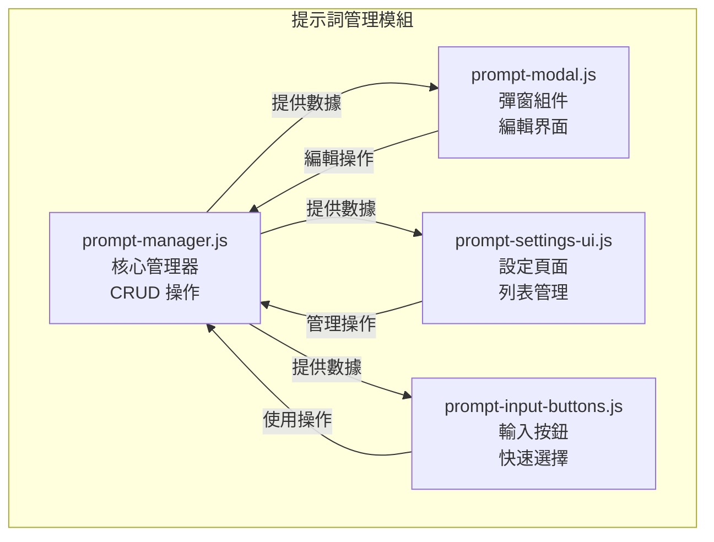

**核心功能**：
- **PromptManager**: 提示詞的增刪改查、排序、自動提交標記
- **PromptModal**: 新增/編輯提示詞的彈窗界面
- **PromptSettingsUI**: 設定頁籤中的提示詞管理界面
- **PromptInputButtons**: 回饋輸入區的快速選擇按鈕

#### 會話管理模組群組 (session/) - v2.4.3 重構增強

**模組結構**：
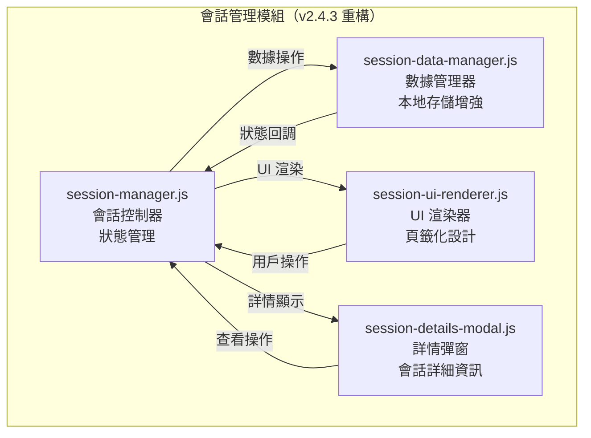

**v2.4.3 重構亮點**：
- **從側邊欄遷移到頁籤**: 解決瀏覽器相容性問題
- **伺服器端歷史存儲**: 存在 `session_history.json`，保存期限可選 24、72、168、720 小時（預設 72）
- **隱私控制**: 「使用者訊息記錄」的隱私等級分三級（完整記錄／基本統計／停用記錄）
- **數據管理**: 匯出和清理功能
- **UI 重新設計**: 專門的渲染器和詳情彈窗

**核心功能**：
- **SessionManager**: 當前會話的狀態管理和控制
- **SessionDataManager**: 會話歷史記錄、統計數據，以及透過 `/api/load-session-history`、`/api/save-session-history` 讀寫伺服器端歷史。`updateStats()` 從會話歷史計算 `todayCount`（今日建立的會話數）與 `averageDuration`（這些會話的平均持續時間，秒）；持續時間與歷史卡片同一個定義 `TimeUtils.calculateSessionDuration()`：從 `created_at` 到 `completed_at`，沒有結束時間時用最後一則用戶訊息的時間，算不出來的會話不列入，也排除 24 小時以上的值
- **SessionUIRenderer**: 專門的 UI 渲染器，負責會話列表和狀態顯示。`renderStats()` 更新會話頁籤的「今日會話」與「今日平均持續時間」；浮動統計面板（`#statsPanel`）的「會話」是歷史清單筆數（`renderSessionHistory()` 寫入 `#statsSessionCount`），「狀態」跟著當前會話（`renderCurrentSession()` 寫入 `#statsSessionStatus`）
- **SessionDetailsModal**: 會話詳情彈窗，提供完整的會話資訊查看

#### 音效通知模組群組 (audio/) - v2.4.3 新增

**模組結構**：
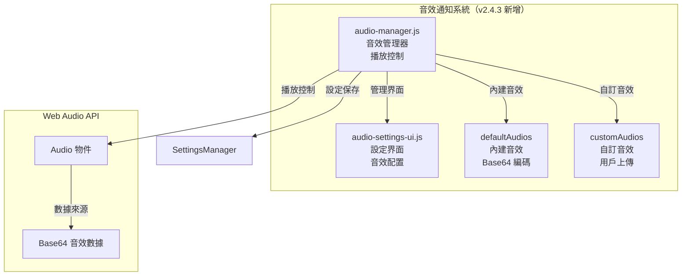

**核心功能**：
- **AudioManager**: 音效播放控制、音量管理、音效選擇
- **AudioSettingsUI**: 音效設定界面、上傳管理、測試播放
- **內建音效**: 經典提示音、通知鈴聲、輕柔鐘聲
- **自訂音效**: 支援 MP3、WAV、OGG 格式上傳和管理

**技術特性**：
- **Web Audio API**: 使用原生 Audio 物件進行播放
- **Base64 存儲**: 音效文件以 Base64 格式經 SettingsManager 存在伺服器端 `ui_settings.json` 的 `customAudios`
- **音量控制**: 0-100% 可調節音量
- **瀏覽器相容性**: 處理自動播放政策限制

#### 智能記憶功能 - v2.4.3 新增

**輸入框高度管理**：
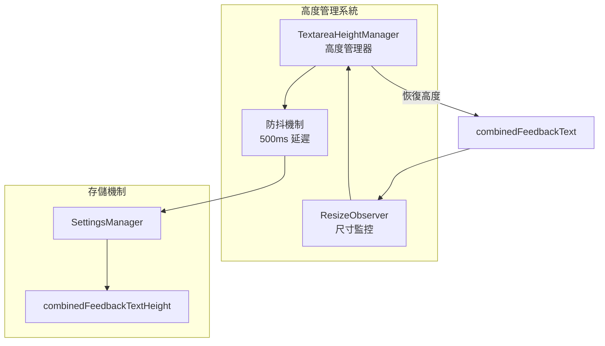

**一鍵複製功能**：
- **專案路徑複製**: 點擊路徑文字即可複製到剪貼簿
- **會話ID複製**: 點擊會話ID即可複製
- **複製反饋**: 視覺提示複製成功狀態
- **國際化支援**: 複製提示支援多語言

#### 自動提交功能整合

**整合架構**：
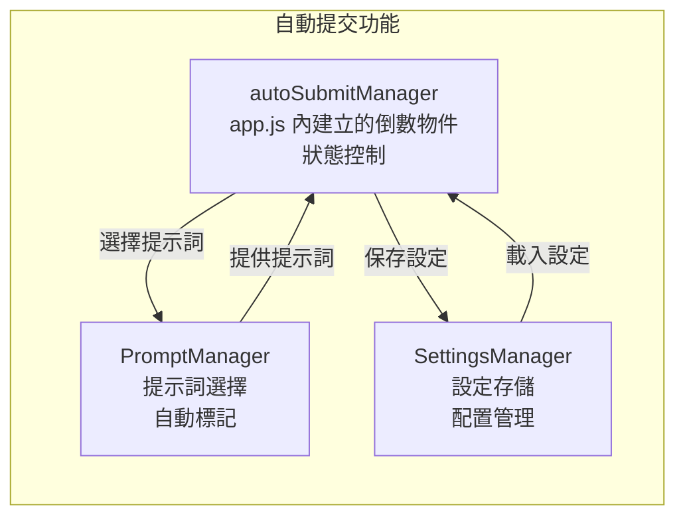

### templates/ - HTML 模板系統

**模板結構**（`feedback.html` 節錄；`GET /` 有活躍會話時渲染此頁，沒有會話時渲染 `index.html` 等待頁）：
```html
<!DOCTYPE html>
<html lang="zh-CN" id="html-root">
<head>
    <title>{{ title }}</title>
    <link rel="stylesheet" href="/static/css/styles.css?v=...">
    <!-- 另載 session-management / prompt-management / audio-management / notification-settings.css -->
</head>
<body class="layout-{{ layout_mode }}">
    <!-- 頂部狀態列：專案路徑 projectPathDisplay、會話 ID currentSessionId（皆可點擊複製）、
         自動提交倒數 countdownDisplay、會話超時倒數 sessionTimeoutDisplay、連線狀態 connectionStatusMinimal -->
    <div class="connection-monitor-bar compact">...</div>

    <div class="container">
        <main class="main-content">
            <div class="tab-buttons">
                <button class="tab-button active" data-tab="combined" data-i18n="tabs.combined">...</button>
                <button class="tab-button" data-tab="summary" data-i18n="tabs.summary">...</button>
                <button class="tab-button" data-tab="sessions" data-i18n="tabs.sessions">...</button>
                <button class="tab-button" data-tab="settings" data-i18n="tabs.settings">...</button>
                <button class="tab-button" data-tab="about" data-i18n="tabs.about">...</button>
            </div>

            <div id="tab-summary" class="tab-content">...</div>
            <div id="tab-combined" class="tab-content active">
                <!-- AI 摘要、回饋輸入框 combinedFeedbackText、圖片上傳 -->
                
            </div>
            <div id="tab-sessions" class="tab-content">...</div>
            <div id="tab-settings" class="tab-content">...</div>
            <div id="tab-about" class="tab-content">...</div>
        </main>
    </div>

    <script src="/static/js/vendor/marked.min.js"></script>
    <script src="/static/js/vendor/purify.min.js"></script>
    <script src="/static/js/i18n.js?v=..."></script>
    <script src="/static/js/modules/logger.js?v=..."></script>
    <!-- modules/utils/、session/、prompt/、audio/、notification/ 子模組 -->
    <script src="/static/js/modules/utils.js?v=..."></script>
    <script src="/static/js/modules/websocket-manager.js?v=..."></script>
    <script src="/static/js/modules/connection-monitor.js?v=..."></script>
    <script src="/static/js/modules/session-manager.js?v=..."></script>
    <script src="/static/js/modules/file-upload-manager.js?v=..."></script>
    <script src="/static/js/modules/image-handler.js?v=..."></script>
    <script src="/static/js/modules/settings-manager.js?v=..."></script>
    <script src="/static/js/modules/ui-manager.js?v=..."></script>
    <script src="/static/js/modules/textarea-height-manager.js?v=..."></script>
    <script src="/static/js/app.js?v=..."></script>
    <!-- 內嵌腳本：等 marked/DOMPurify 載入後以 {{ session_id }} 建立 FeedbackApp -->
</body>
</html>
```

**模板特性**：
- **Jinja2 模板引擎**: 支援變數替換和條件渲染；`components/` 下有 `image-upload.html` 等可重用片段
- **佈局模式**: `layout_mode` 由 `load_user_layout_settings()` 從 `ui_settings.json` 讀出，套到 `<body>` 的 class
- **國際化支援**: `data-i18n` 屬性由前端 `i18n.js` 翻譯
- **Markdown 摘要**: 以 marked 轉換、DOMPurify 過濾後顯示
- **無障礙設計**: 支援鍵盤導航和螢幕閱讀器

### static/js/ - JavaScript 模組系統

**模組化架構**：
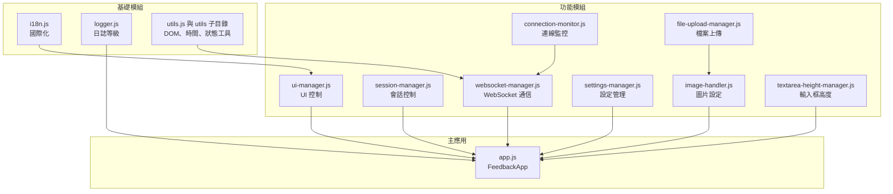

**主要模組說明**：

**app.js - 主應用程式**（節錄，實際以 prototype 與 Promise 鏈實作）：
```javascript
function FeedbackApp(sessionId) {
    this.sessionId = sessionId;
    this.currentSessionId = null;

    // 模組管理器
    this.webSocketManager = null;
    this.connectionMonitor = null;
    this.sessionManager = null;
    this.imageHandler = null;
    this.settingsManager = null;
    this.uiManager = null;
    // 另有 promptManager、audioManager、notificationManager、autoSubmitManager 等

    this.isInitialized = false;
}

FeedbackApp.prototype.init = function() {
    const self = this;
    return self.waitForI18n()
        .then(function() { return self.initializeManagers(); })
        .then(function() { return self.setupEventListeners(); })
        .then(function() { return self.setupCleanupHandlers(); })
        .then(function() { self.isInitialized = true; });
};
```

提交回饋時，`submitFeedbackInternal()` 先以 `recordUserMessage()` 寫入會話歷史，再透過 WebSocket 送出 `{type: 'submit_feedback', feedback, images, settings}`。

**websocket-manager.js - WebSocket 通信**（節錄）：
```javascript
function WebSocketManager(options) {
    this.websocket = null;
    this.isConnected = false;
    this.connectionReady = false;
    this.heartbeatFrequency = options.heartbeatFrequency || Utils.CONSTANTS.DEFAULT_HEARTBEAT_FREQUENCY;
    this.reconnectAttempts = 0;
    this.maxReconnectAttempts = options.maxReconnectAttempts || Utils.CONSTANTS.MAX_RECONNECT_ATTEMPTS; // 5
    this.reconnectDelay = options.reconnectDelay || Utils.CONSTANTS.DEFAULT_RECONNECT_DELAY;         // 1000 毫秒
    this.connectionMonitor = options.connectionMonitor || null;
    // 另有會話超時相關欄位
}

WebSocketManager.prototype.connect = function() {
    const protocol = window.location.protocol === 'https:' ? 'wss:' : 'ws:';
    const wsUrl = protocol + '//' + window.location.host + '/ws';
    const language = window.i18nManager ? window.i18nManager.getCurrentLanguage() : 'zh-TW';
    this.websocket = new WebSocket(wsUrl + '?lang=' + language);
    this.setupWebSocketEvents();
};

WebSocketManager.prototype.send = function(data) {
    if (this.websocket && this.websocket.readyState === WebSocket.OPEN) {
        this.websocket.send(JSON.stringify(data));
        return true;
    }
    return false;
};
```

`processMessage()` 自行處理 `connection_established`、`heartbeat_response`、`ping`（回 `pong`）與 `update_timeout_settings`，所有訊息再交給 `onMessage` 回呼（`FeedbackApp.handleWebSocketMessage()`）；`startHeartbeat()` 依 `heartbeatFrequency`（60000 毫秒）定期送出 `heartbeat`。

斷線時 `handleClose()` 依關閉碼決定是否重連：`4004`（沒有活躍會話）與 `1000`（正常關閉）不重連，瀏覽器離線時也不重連；其他情況由 `handleReconnection()` 以指數退避（1 秒 × 2^(N−1)，加 0–1 秒抖動，最多 30 秒）重連，最多 5 次。連線成功時 `handleOpen()` 把重連次數歸零。

**connection-monitor.js - 連線監控**：
- `ConnectionMonitor` 從 `WebSocketManager` 的 `onConnectionStatusChange` 接收連線狀態，更新右上角狀態與統計面板
- `reconnectAttempt`：這次斷線後的重連次數，顯示在右上角「重新連線中... (第N次)」，恢復連線時歸零
- `reconnectCount`：整頁累計的重連次數，顯示在統計面板「重新連線」
- 連線時間：連線時 `startMonitoring()` 記下開始時間並每秒更新顯示；斷線時 `stopMonitoring()` 停止並顯示 `--:--`，重連成功後從 0 起算
- 延遲：送出心跳時 `recordPing()`、收到 `heartbeat_response` 時 `recordPong()`，以時間差計算延遲並保留最近 20 筆平均，換算成訊號強度

**image-handler.js / file-upload-manager.js - 圖片處理**：
- `ImageHandler` 管圖片設定（大小上限 `imageSizeLimit`、`enableBase64Detail`），實際的檔案處理交給它建立的 `FileUploadManager`；對外提供 `getImages()`、`clearImages()`、`updateSettings()`
- `FileUploadManager` 處理點擊選檔、拖放、全域貼上；`processFiles()` 只收 `image/*`，檢查大小上限（`0` 表示不限制）與數量上限（預設 10 張），`fileToBase64()` 以 `FileReader` 轉成 Base64
- 前端與後端都**不壓縮**圖片；後端 `WebFeedbackSession._process_images()` 再依 `image_size_limit` 過濾並解碼成 bytes

**前端特性總結**：
- **模組化設計**: 清晰的職責分離和依賴管理
- **響應式 UI**: 適配不同螢幕尺寸和設備
- **實時通信**: WebSocket 雙向數據同步
- **圖片處理**: 大小與數量限制、轉成 Base64 傳送（不壓縮、不轉格式）
- **國際化**: 動態語言切換和本地化
- **錯誤處理**: 優雅的錯誤恢復機制
- **性能優化**: 靜態資源快取標頭、WebSocket 訊息防抖
- **無障礙支援**: 鍵盤導航和螢幕閱讀器支援

### static/css/ - 樣式系統（v2.4.3 擴展）

**樣式文件結構**：
```
static/css/
├── styles.css                  # 主樣式文件（:root 色彩變數）
├── prompt-management.css       # 提示詞管理樣式
├── session-management.css      # 會話管理樣式
├── audio-management.css        # 音效管理樣式（v2.4.3 新增）
└── notification-settings.css   # 瀏覽器通知設定樣式
```

**v2.4.3 新增樣式特性**：

**audio-management.css - 音效管理樣式**（節錄）：
```css
/* 音效設定控制項 */
.audio-setting-item {
    display: flex;
    flex-direction: column;
    gap: 8px;
}

/* 音量控制滑桿 */
.audio-volume-slider {
    flex: 1;
    height: 6px;
    background: var(--bg-secondary);
    border-radius: 3px;
    outline: none;
    cursor: pointer;
}
```
其他主要選擇器：`.audio-volume-control`、`.audio-select`、`.audio-test-btn`、`.audio-upload-btn`、`.audio-custom-list`、`.audio-custom-item`、`.audio-name-modal`。

**session-management.css - 會話管理樣式**（節錄）：
```css
/* 會話卡片樣式 */
.session-card {
  background: var(--bg-secondary);
  border: 1px solid var(--border-color);
  border-radius: 8px;
  padding: 12px;
  margin-bottom: 12px;
  transition: all var(--transition-fast) ease;
  cursor: pointer;
}

.session-card:hover {
  border-color: var(--accent-color);
  box-shadow: 0 2px 8px rgba(0, 122, 204, 0.2);
}

/* 一鍵複製的提示訊息 */
.copy-toast {
  position: fixed;
  top: 20px;
  right: 20px;
  transition: all 0.3s ease;
}
```

**響應式設計增強**：
- **移動設備優化**: 768px 以下音量、音效選擇與自訂音效項目改為垂直排列
- **觸控友好**: 按鈕和滑桿適配觸控操作
- **視覺反饋**: 懸停和點擊狀態的視覺提示
- **深色配色**: 固定使用 `styles.css` `:root` 的深色變數，沒有主題切換

## 🛠️ 工具層組件

### utils/error_handler.py - 錯誤處理框架

**統一錯誤處理**：全部是 `ErrorHandler` 的 `@staticmethod`，只寫 debug log、產生給使用者看的文字，不影響 MCP 的 JSON-RPC 回應。
```python
class ErrorType(Enum):
    NETWORK = "network"
    FILE_IO = "file_io"
    PROCESS = "process"
    TIMEOUT = "timeout"
    USER_CANCEL = "user_cancel"
    SYSTEM = "system"
    PERMISSION = "permission"
    VALIDATION = "validation"
    DEPENDENCY = "dependency"
    CONFIGURATION = "config"

class ErrorSeverity(Enum):
    LOW = "low"
    MEDIUM = "medium"
    HIGH = "high"
    CRITICAL = "critical"

class ErrorHandler:
    @staticmethod
    def classify_error(error: Exception) -> ErrorType:
        """依例外類型與訊息自動分類"""

    @staticmethod
    def log_error_with_context(error, context=None, error_type=None,
                               severity=ErrorSeverity.MEDIUM) -> str:
        """寫入 debug log 並回傳錯誤 ID（ERR_<時間戳>_<編號>）；HIGH/CRITICAL 另記堆疊"""

    @staticmethod
    def format_user_error(error, error_type=None, context=None,
                          include_technical=False) -> str:
        """產生給使用者看的錯誤文字，語言跟隨 I18nManager 目前語言；
        「操作／檔案／技術細節」前綴依語言取自 _CONTEXT_LABELS"""

    @staticmethod
    def get_current_language() -> str:
        """取 I18nManager 目前語言，失敗時用 MCP_LANGUAGE，預設 zh-TW"""

    @staticmethod
    def get_error_message(error_type: ErrorType) -> str:
        """依目前語言取 _ERROR_MESSAGES 中的錯誤類型訊息，缺語言時用 zh-TW"""
```

**典型用法**（`server.py` 的 `interactive_feedback`）：先 `log_error_with_context()` 取得錯誤 ID，再用 `format_user_error(e, include_technical=False)` 產生文字，包成 `TextContent` 回給 AI。

### utils/memory_monitor.py - 記憶體監控

**資源監控**：
```python
class MemoryMonitor:
    def __init__(self, warning_threshold: float = 0.8, critical_threshold: float = 0.9,
                 emergency_threshold: float = 0.95, monitoring_interval: int = 30,
                 max_snapshots: int = 1000): ...

    def start_monitoring(self) -> bool: ...
    def stop_monitoring(self) -> bool: ...
    def get_current_memory_info(self) -> dict[str, Any]:
        """系統與本程序的記憶體用量（GB/MB 與百分比）"""
    def get_memory_stats(self) -> MemoryStats: ...
    def add_cleanup_callback(self, callback: Callable): ...
    def add_alert_callback(self, callback: Callable[[MemoryAlert], None]): ...

def get_memory_monitor() -> MemoryMonitor:
    """取得全域實例"""
```

**運作方式**：
- 背景執行緒每 30 秒取一次快照，依**系統**記憶體使用率判斷：≥ 80% 發 `warning` 警告；≥ 90% 發 `critical` 並執行 `gc.collect()` 與清理回呼；≥ 95% 發 `emergency`，強制回收並以 `force=True` 呼叫清理回呼
- `WebUIManager._setup_memory_monitoring()` 註冊回呼：`critical` 時呼叫 `cleanup_expired_sessions()`，`emergency` 時呼叫 `cleanup_sessions_by_memory_pressure(force=True)`

### utils/resource_manager.py - 資源管理

**生命週期管理**：`ResourceManager` 是單例（`__new__` 加鎖），透過 `get_resource_manager()` 取得。
```python
class ResourceManager:
    def create_temp_file(self, suffix: str = "", prefix: str = "mcp_",
                         dir: str | None = None, text: bool = True) -> str:
        """建立並追蹤臨時文件"""

    def create_temp_dir(self, suffix: str = "", prefix: str = "mcp_",
                        dir: str | None = None) -> str: ...

    def cleanup_temp_files(self, max_age: int | None = None) -> int: ...
    def cleanup_temp_dirs(self) -> int: ...
    def cleanup_file_handles(self) -> int: ...

    def cleanup_all(self, force: bool = False) -> dict[str, int]:
        """依序清理文件句柄、全部臨時文件、臨時目錄，回傳各類清理數量"""
```

**運作方式**：
- 初始化時以 `atexit` 註冊 `cleanup_all`，並啟動每 300 秒執行一次的自動清理執行緒（清除超過 1 小時的臨時文件）；另向 `MemoryMonitor` 註冊清理回呼，記憶體達 `critical` 以上時清理臨時文件、臨時目錄與文件句柄
- 實際呼叫端：`server.py` 的 `save_feedback_to_file()` 用模組函式 `create_temp_file(suffix=".json", prefix="feedback_")` 把每次回饋存成臨時 JSON

### web/utils/browser.py - 瀏覽器控制

**瀏覽器開啟**：沒有類別，都是模組函式。
```python
def is_wsl_environment() -> bool:
    """非 Linux 一律 False；Linux 上檢查 /proc/version、WSL 環境變數等"""

def is_desktop_mode() -> bool:
    """MCP_DESKTOP_MODE=true 時為桌面模式"""

def open_browser_in_wsl(url: str) -> None:
    """依序試 cmd.exe /c start、powershell.exe Start-Process、wslview；全部失敗拋例外"""

def smart_browser_open(url: str) -> bool:
    if is_desktop_mode():
        return True               # 桌面殼本身就是介面，不開瀏覽器
    if is_wsl_environment():
        open_browser_in_wsl(url)
        return True
    return webbrowser.open(url)   # 其他環境（含 SSH 遠端）都用標準 webbrowser

def get_browser_opener() -> Callable[[str], bool]:
    return smart_browser_open
```

**SSH 遠端**：沒有專門處理，不會建立 SSH 隧道。在無桌面的遠端主機上 `webbrowser.open` 通常回傳 False，`WebUIManager.open_browser()` 便用 `user_notice()` 在 stderr 印出網址，由使用者自行轉發埠後開啟。

### web/utils/port_manager.py - 埠管理

**動態埠分配**：`PortManager` 全部是 `@staticmethod`，沒有實例狀態，也沒有「釋放埠」的方法。
```python
class PortManager:
    @staticmethod
    def is_port_available(host: str, port: int) -> bool:
        """先嘗試 bind；失敗時再用 psutil 確認是否真的有程序在 LISTEN"""

    @staticmethod
    def find_free_port_enhanced(preferred_port: int = 8765, auto_cleanup: bool = True,
                                host: str = "127.0.0.1", max_attempts: int = 100) -> int:
        """偏好埠可用就用；被占用且 auto_cleanup 時，只終止本專案或 uvicorn/fastapi 的
        Python 程序；仍不可用就往上找 max_attempts 個，再往下找（不低於 1024），
        都找不到拋 RuntimeError"""

    @staticmethod
    def find_process_using_port(port: int) -> dict[str, Any] | None: ...
    @staticmethod
    def kill_process_on_port(port: int, force: bool = False) -> bool: ...
    @staticmethod
    def get_port_status(port: int, host: str = "127.0.0.1") -> dict[str, Any]: ...
```

**埠的決定順序**（`WebUIManager.__init__`）：`MCP_WEB_PORT` 環境變數（1024–65535，或 `0` 表示由系統分配）> 預設 8765，再交給 `find_free_port_enhanced()`；`MCP_TEST_MODE=true` 時不清理占用程序。`start_server()` 啟動前若埠又被占用，會以 `auto_cleanup=False` 再找一次；uvicorn 啟動時遇到「位址已在使用中」則改用下一個埠，最多重試 5 次。

### 會話清理流程

沒有獨立的會話清理管理器；會話清理由下列路徑負責：

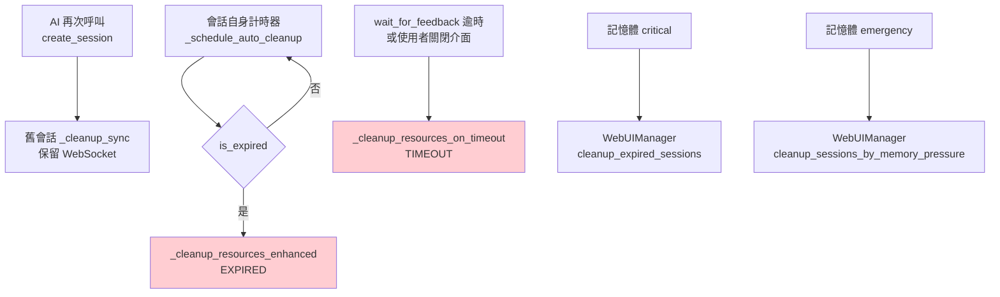

**清理內容**（`WebFeedbackSession._cleanup_resources_enhanced`）：
- 取消自動清理、使用者超時、斷線寬限三種計時器
- 透過 WebSocket 送出 `notification`（訊息代碼依 `CleanupReason` 而定）後關閉連線
- 設定 `feedback_completed` 事件，清空圖片與設定
- 依原因把狀態設為 `EXPIRED`／`TIMEOUT`／`ERROR`，其餘設為 `COMPLETED`
- 執行已註冊的清理回呼並記錄清理統計

**過期判斷**（`is_expired`）：空閒超過 `max_idle_time`（預設 1800 秒）、狀態為 `EXPIRED`，或處於 `ERROR`／`TIMEOUT` 超過 300 秒。會話建立時即排定計時器（`auto_cleanup_delay` 預設 3600 秒），進入 `FEEDBACK_SUBMITTED` 時重新排定。

### web/utils/compression_config.py - 壓縮工具

**實際作用範圍**：
- **HTTP Gzip**: `WebUIManager._setup_compression_middleware()` 加上 FastAPI 的 `GZipMiddleware`，`minimum_size` 與 `compresslevel` 取自 `CompressionConfig`（預設 1000 bytes 與 6，可用 `MCP_GZIP_MIN_SIZE`、`MCP_GZIP_LEVEL` 調整）
- **快取標頭**: 同一個中介層依 `CompressionConfig.get_cache_headers()` 設定：`/static/` 快取 3600 秒（`MCP_STATIC_CACHE_AGE`），`/api/` 預設不快取，其餘回應 `no-cache`；`/ws` 等路徑排除
- **統計**: `CompressionManager.update_stats()` 累計請求數與壓縮比
- **沒有**圖片壓縮，也不壓縮 WebSocket 訊息

## 🧪 測試架構

### 測試組織結構

```
tests/
├── unit/                    # 單元測試
│   ├── test_cross_site_writes.py
│   ├── test_desktop_fallback.py
│   ├── test_error_handler.py
│   ├── test_feedback_timeout.py
│   ├── test_gzip_compression.py
│   ├── test_i18n_core.py
│   ├── test_image_content.py
│   ├── test_memory_monitor.py
│   ├── test_message_code_translations.py
│   ├── test_no_command_execution.py
│   ├── test_port_manager.py
│   ├── test_resource_manager.py
│   ├── test_session_cleanup.py
│   ├── test_tool_contract.py
│   ├── test_user_notice.py
│   ├── test_web_ui.py
│   ├── test_websocket_origin.py
│   └── test_wsl_detection.py
├── integration/             # 集成測試
│   ├── test_mcp_workflow.py
│   ├── test_web_integration.py
│   ├── test_web_ui_boot.py
│   └── test_i18n_integration.py
├── helpers/                 # 測試輔助工具
│   ├── mcp_client.py
│   ├── test_utils.py
│   └── manual_tooltip_test.html
├── fixtures/                # 測試數據
│   └── test_data.py
└── conftest.py             # pytest 配置
```

### 測試策略

**單元測試**：
- 每個工具模組的獨立測試
- 數據模型的驗證測試
- 錯誤處理機制測試
- 國際化功能測試

**集成測試**：
- MCP 工具完整工作流程
- Web UI 與後端交互
- WebSocket 通信測試
- 多語言切換測試

**性能測試**（只有少數有時間門檻的測試，沒有獨立的效能測試套件或基準）：
- MCP 啟動與初始化時間：`TestMCPPerformance.test_startup_performance` 要求以 stdio 啟動伺服器在 30 秒內、`initialize` 在 5 秒內完成（`integration/test_mcp_workflow.py`）
- 同時啟動兩個 MCP 客戶端：`test_concurrent_initialization` 只要求至少一個成功並能初始化，不量測時間（同上）
- Web 服務啟動時間：`TestWebUIPerformance.test_server_startup_time` 要求 `start_server()` 加上等待 3 秒總計在 10 秒內，且伺服器執行緒仍在執行（`integration/test_web_integration.py`）
- 連續建立會話：`test_multiple_session_performance` 連續建立 10 個會話，平均每個要在 0.1 秒內，最後一個是目前活躍會話（同上）
- Gzip 壓縮比：`test_compression_performance` 對約 5KB 的 JSON 直接呼叫 `gzip.compress`，要求壓縮比超過 50%，不經過伺服器（`unit/test_gzip_compression.py`）
- 記憶體監控、資源清理與會話清理只有功能測試（`unit/test_memory_monitor.py` 以模擬的 `psutil` 數值驗證門檻分級與清理回呼；`unit/test_resource_manager.py`、`unit/test_session_cleanup.py` 驗證清理與過期判斷），不量測記憶體用量或清理耗時；沒有並發 WebSocket 連線的測試

## 🔧 開發工具鏈

### 代碼品質工具

**Ruff (Linting + Formatting)**：設定在 `pyproject.toml` 的 `[tool.ruff]`
- 目標 `py311`、行長 88；規則集含 E/W/F、`I`（import 排序）、B、UP、`S`（bandit 安全規則）、PL、RUF 等
- `C90` 雖在規則集內，但 `C901`（函式複雜度）列在 ignore，實際不檢查
- 本機：`make lint`（`ruff check .`）、`make format-check`（`ruff format . --check`）

**mypy (類型檢查)**：設定在 `pyproject.toml` 的 `[tool.mypy]`
- 檢查 `src` 與 `tests`，`check_untyped_defs = true`，`disallow_untyped_defs = false`（漸進式）
- `fastmcp`、`mcp`、`psutil`、`uvicorn` 等第三方模組設為 `ignore_missing_imports`
- 本機：`make type-check`（`uv run mypy`）

**CI（`.github/workflows/test.yml` 的 Tests workflow）**：
- 在 ubuntu 執行 `uv run ruff check .`、`uv run ruff format --check .`、`uv run mypy`
- 在 ubuntu 與 windows 執行 `uv run pytest`

**pre-commit (提交檢查)**：
- 通用檔案檢查（pre-commit-hooks v5.0.0）：行尾空白、檔尾換行、合併衝突標記、YAML/TOML/JSON 語法、大檔案（1000 KB）、檔名大小寫衝突、可執行檔 shebang、統一 LF 行尾
- ruff-pre-commit v0.17.2 的 `ruff-check`（`--fix`）與 `ruff-format`
- mypy 與 bandit hook 目前在設定檔中註解停用（mypy 由 CI 執行）
- 不執行測試

### 依賴管理

**uv (現代 Python 包管理)**：
- 快速依賴解析
- `uv sync --dev` 安裝 `[dependency-groups]` 的開發依賴（ruff、mypy、pre-commit 等）；`uv.lock` 列在 `.gitignore`，不進版本控制，CI 每次重新解析依賴，因此 lint 工具釘死版本（`ruff==0.17.2`、`mypy==2.4.0`），ruff 版本要和 `.pre-commit-config.yaml` 的 `ruff-pre-commit` rev 一起升級
- 開發環境隔離
- 跨平台支援

---

## 📚 相關文檔

- **[系統架構總覽](./system-overview.md)** - 了解整體架構設計理念
- **[交互流程文檔](./interaction-flows.md)** - 詳細的用戶交互和系統流程
- **[API 參考文檔](./api-reference.md)** - 完整的 API 端點和參數說明
- **[部署指南](./deployment-guide.md)** - 環境配置和部署最佳實踐
