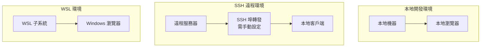
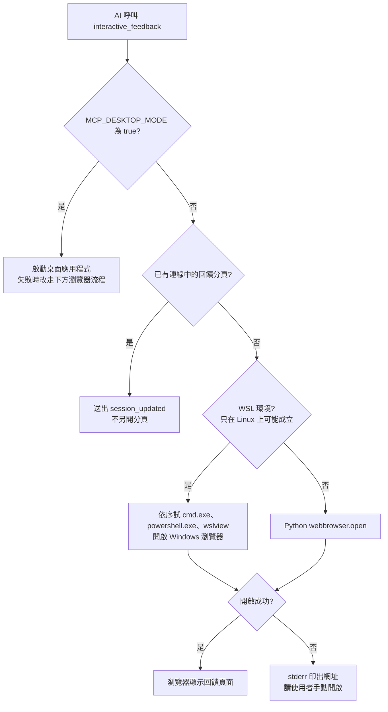

# 部署指南

## 🚀 部署架構概覽

MCP Feedback Enhanced 支援本地、SSH 遠端、WSL 與桌面應用程式等使用方式；程式只依環境決定怎麼開啟介面，遠端存取需要自行設定埠轉發。

### 部署拓撲圖



## 🛠️ 安裝和配置

### 系統要求

#### 最低要求
- **Python**: 3.11 或更高版本
- **內存**: 512MB 可用內存
- **磁盤**: 100MB 可用空間
- **網路**: 可訪問的網路連接
- **瀏覽器**: 支援 Web Audio API 的現代瀏覽器（v2.4.3 音效功能）

#### 推薦配置
- **Python**: 3.12+
- **內存**: 1GB+ 可用內存
- **磁盤**: 500MB+ 可用空間（包含音效文件存儲）
- **CPU**: 2 核心或更多
- **瀏覽器**: Chrome 90+, Firefox 88+, Safari 14+（完整功能支援）

### 安裝方式

套件提供 `mcp-feedback-enhanced` 指令（另有相容別名 `interactive-feedback-mcp`）。不帶子命令時啟動 MCP 伺服器（stdio），通常由 IDE 依 MCP 設定啟動，不需要手動常駐；Web 服務在 AI 第一次呼叫 `interactive_feedback` 時才啟動。

#### 1. 使用 uvx（推薦）
```bash
# 啟動 MCP 伺服器（等同 `server` 子命令）
uvx mcp-feedback-enhanced@latest

# 指定版本
uvx mcp-feedback-enhanced@2.8.4

# 不經 MCP 客戶端，單獨測試 Web UI
uvx mcp-feedback-enhanced@latest test --web
```

#### 2. 使用 pip
```bash
# 安裝
pip install mcp-feedback-enhanced

# 運行
mcp-feedback-enhanced
```

#### 3. 從源碼安裝
```bash
# 克隆倉庫
git clone https://github.com/Minidoracat/mcp-feedback-enhanced.git
cd mcp-feedback-enhanced

# 使用 uv 安裝
uv sync

# 運行
uv run python -m mcp_feedback_enhanced
```

## 🌍 環境配置

### 環境檢測機制



SSH、Codespaces、Remote Containers、Docker、Windows 遠端桌面、沒有 `DISPLAY` 的 Linux 會被 `is_remote_environment()` 判定為遠端，但這個結果只寫進除錯日誌與 `get_system_info` 的輸出，不影響上面的開啟流程，也不會建立 SSH 隧道。

### 1. 本地環境部署

**特點**:
- 直接在本地機器運行
- AI 呼叫 `interactive_feedback` 時開啟本地瀏覽器；已有連線中的回饋分頁時改為通知該分頁更新內容，不另開新分頁
- 最簡單的部署方式

**配置**:
```bash
# 由 IDE 依 MCP 設定啟動，或手動運行
uvx mcp-feedback-enhanced@latest

# 預設地址: http://127.0.0.1:8765
# 可用 MCP_WEB_HOST、MCP_WEB_PORT 調整；埠被佔用時會改用附近的可用埠
```

### 2. SSH 遠程環境部署

**特點**:
- 在遠程服務器運行 MCP 伺服器與 Web 服務
- 不會自動建立 SSH 隧道，需自行設定埠轉發，再用本地瀏覽器訪問
- 遠端無法開啟瀏覽器時，伺服器會在 stderr 印出網址，供手動開啟

**配置步驟**:

1. **在遠程服務器安裝**:
```bash
# SSH 連接到遠程服務器
ssh user@remote-server

# 安裝服務
pip install mcp-feedback-enhanced
```

2. **固定埠號**（在 MCP 設定的 `env` 中設定）:
```json
{
    "MCP_WEB_PORT": "8765"
}
```

`MCP_WEB_HOST` 請維持預設的 `127.0.0.1`。Web UI 與 `/ws` 端點沒有認證機制，設成 `0.0.0.0` 等於讓能連到該埠的任何人讀取會話內容並提交回饋。

3. **建立 SSH 埠轉發**:
```bash
ssh -L 8765:127.0.0.1:8765 user@remote-server
```

### 3. WSL 環境部署

**特點**:
- 在 WSL 中運行 MCP 伺服器與 Web 服務
- 只在 Linux 上判斷是否為 WSL：`/proc/version` 含 `microsoft` 或 `wsl`、設了 `WSL_DISTRO_NAME`／`WSL_INTEROP`／`WSLENV`，或存在 `/mnt/c`、`/mnt/d`、`/proc/sys/fs/binfmt_misc/WSLInterop`；原生 Windows 即使設了 `WSLENV` 也不算 WSL
- 偵測到 WSL 時依序用 `cmd.exe /c start`、`powershell.exe Start-Process`、`wslview` 開啟 Windows 瀏覽器；三種都失敗時在 stderr 印出網址

**配置**:
```bash
# 在 WSL 中運行（通常由 IDE 依 MCP 設定啟動）
uvx mcp-feedback-enhanced@latest
```

## ⚙️ 配置選項

### 命令行參數

```bash
mcp-feedback-enhanced [server | test (--web | --desktop) | version]
```

| 子命令／參數 | 描述 |
|------|------|
| （無）或 `server` | 啟動 MCP 伺服器（stdio） |
| `test --web` | 啟動 Web UI 測試並持續運行 |
| `test --desktop` | 啟動桌面應用程式 |
| `test --timeout N` | 可接受（預設 60），但目前沒有被使用 |
| `version` | 顯示版本資訊 |

`test` 不帶 `--web` 或 `--desktop` 時只印出說明並以狀態碼 1 結束。主機、埠、除錯模式沒有命令行參數，一律用下方環境變數設定。

### 環境變數

| 變數 | 用途 | 預設值 |
|------|------|--------|
| `MCP_DEBUG` | `true`/`1`/`yes`/`on` 時把除錯日誌寫到 stderr | 關閉 |
| `MCP_WEB_HOST` | Web 服務綁定的主機 | `127.0.0.1` |
| `MCP_WEB_PORT` | Web 服務埠，`1024`-`65535`；`0` 表示由系統分配 | `8765` |
| `MCP_DESKTOP_MODE` | `true` 時改用桌面應用程式 | 關閉 |
| `MCP_LANGUAGE` | 強制指定介面語言（`zh-TW`、`zh-CN`、`en`） | 自動偵測 |
| `MCP_GZIP_MIN_SIZE` | 回應超過此位元組數才 Gzip 壓縮 | `1000` |
| `MCP_STATIC_CACHE_AGE` | `/static/` 的快取秒數 | `3600` |
| `MCP_API_CACHE_AGE` | `/api/` 的快取秒數，`0` 表示不加快取標頭 | `0` |

```bash
# 範例
export MCP_WEB_PORT=9000
export MCP_DEBUG=true
export MCP_LANGUAGE=en
```

### 設定檔

沒有 `config.json`。Web UI 的設定由瀏覽器端 `SettingsManager` 透過 HTTP API 存到 `~/.config/mcp-feedback-enhanced/`：

| 檔案 | 內容 | 讀寫方式 |
|------|------|----------|
| `ui_settings.json` | 介面設定，包含提示詞（`promptSettings`）、音效與自訂音效（`audioNotificationEnabled`、`audioNotificationVolume`、`selectedAudioId`、`customAudios`）、會話歷史保存期限（`sessionHistoryRetentionHours`）、用戶訊息記錄（`userMessageRecordingEnabled`、`userMessagePrivacyLevel`）、輸入框高度（`combinedFeedbackTextHeight`）、會話超時（`sessionTimeoutEnabled`、`sessionTimeoutSeconds`）、日誌等級（`logLevel`） | `GET /api/load-settings`、`POST /api/save-settings`、`POST /api/clear-settings`、`POST /api/log-level` |
| `session_history.json` | 會話歷史 | `GET /api/load-session-history`、`POST /api/save-session-history` |
| `language.json` | 伺服器端語言設定 | Python `I18nManager` |

瀏覽器 localStorage 只存介面語言（`language`）與瀏覽器通知設定（`notificationsEnabled`、`notificationTriggerMode`）。

## 🆕 v2.4.3 版本部署考慮

### 音效通知系統部署

#### 瀏覽器相容性檢查
```javascript
// 檢查 Web Audio API 支援
function checkAudioSupport() {
    if (typeof Audio === 'undefined') {
        console.warn('Web Audio API 不支援，音效功能將被停用');
        return false;
    }
    return true;
}
```

#### 音效文件存儲
沒有獨立的音效儲存設定。自訂音效轉成 Base64 後存在 `ui_settings.json` 的 `customAudios`，接受 `audio/mp3`、`audio/mpeg`、`audio/wav`、`audio/ogg`。程式沒有檔案大小或數量上限，上傳大檔會讓 `ui_settings.json` 跟著變大。

#### 自動播放政策處理
```bash
# 部署時需要考慮瀏覽器自動播放限制
# Chrome: 需要用戶交互後才能播放音效
# Firefox: 預設允許音效播放
# Safari: 需要用戶手勢觸發
```

### 會話管理重構部署

#### 會話歷史存儲
會話歷史存在伺服器端的 `~/.config/mcp-feedback-enhanced/session_history.json`，由前端經 `POST /api/save-session-history` 寫入、`GET /api/load-session-history` 讀取，不佔用瀏覽器 localStorage。載入時會移除超過保存期限的會話；保存期限是設定 `sessionHistoryRetentionHours`，介面可選 24、72、168、720 小時，預設 72。

#### 隱私設定
隱私相關設定都存在 `ui_settings.json`：

| 設定鍵 | 可選值 | 預設值 |
|--------|--------|--------|
| `userMessageRecordingEnabled` | `true`/`false` | `true` |
| `userMessagePrivacyLevel` | `full`、`basic`、`disabled` | `full` |

### 智能記憶功能部署

#### ResizeObserver 支援檢查
```javascript
// 檢查 ResizeObserver 支援
if (typeof ResizeObserver === 'undefined') {
    console.warn('ResizeObserver 不支援，高度記憶功能將使用 fallback');
    // 使用 window.resize 事件作為 fallback
}
```

#### 設定存儲
輸入框高度在調整後延遲 500 毫秒（debounce）寫入 `ui_settings.json` 的 `combinedFeedbackTextHeight`，預設 150 像素；沒有其他可調整的記憶設定。

## 🔧 運維管理

### 服務監控

#### 服務狀態檢查
沒有 `/health` 端點。Web 服務啟動後（AI 第一次呼叫 `interactive_feedback` 之後），可用 `GET /api/session-status` 確認服務與目前會話：

```bash
curl http://127.0.0.1:8765/api/session-status
```

```json
{
    "has_session": true,
    "status": "active",
    "session_info": {
        "project_directory": "/path/to/project",
        "summary": "代碼審查完成",
        "feedback_completed": false
    }
}
```

沒有活躍會話時回傳 `has_session: false`、`status: "no_session"`。

#### 日誌監控
程式沒有寫日誌檔。設定 `MCP_DEBUG=true` 時，除錯訊息寫到 stderr；預設不輸出，避免干擾 MCP 的 stdio 通訊。

### 性能調優

會話清理與 WebSocket 連線沒有可調整的設定；可用環境變數調整的只有 Gzip 門檻與快取時間（`MCP_GZIP_MIN_SIZE`、`MCP_STATIC_CACHE_AGE`、`MCP_API_CACHE_AGE`，見上方環境變數表）。

### 故障排除

#### 常見問題

**v2.4.3 新增問題**：

1. **音效無法播放**
```bash
# 檢查瀏覽器自動播放政策
# 解決方案：用戶需要先與頁面交互
console.log('請點擊頁面任意位置以啟用音效功能');

# 檢查音效文件格式
# 支援格式：MP3, WAV, OGG
# 程式沒有限制檔案大小
```

2. **會話歷史丟失**
```bash
# 會話歷史存在伺服器端，不在 localStorage
cat ~/.config/mcp-feedback-enhanced/session_history.json

# 檢查保存期限：超過 ui_settings.json 的 sessionHistoryRetentionHours（預設 72 小時）的會話會在載入時被移除
# 檢查隱私設定：userMessageRecordingEnabled 為 false 或 userMessagePrivacyLevel 為 disabled 時不記錄用戶訊息
```

3. **輸入框高度不記憶**
```bash
# 檢查 ResizeObserver 支援
if (typeof ResizeObserver === 'undefined') {
    console.warn('瀏覽器不支援 ResizeObserver');
}

# 檢查設定存儲（高度存在 ui_settings.json，不在 localStorage）
grep combinedFeedbackTextHeight ~/.config/mcp-feedback-enhanced/ui_settings.json
```

4. **埠被佔用**
```bash
# 檢查埠使用情況
netstat -tulpn | grep 8765

# 偏好埠被佔用時，若佔用者是本專案或 uvicorn/fastapi 的 Python 行程，會先嘗試結束它；
# 否則自動往上（最多 100 個）再往下尋找可用埠。要固定改用其他埠：
MCP_WEB_PORT=8766 uvx mcp-feedback-enhanced@latest
```

5. **瀏覽器無法開啟**
```bash
# 無法自動開啟時，伺服器會在 stderr 印出「無法自動開啟瀏覽器，請手動開啟：<網址>」
# 依該網址手動開啟即可（預設 http://127.0.0.1:8765）
```

6. **SSH 埠轉發失敗**
```bash
# 手動建立埠轉發
ssh -L 8765:127.0.0.1:8765 user@remote-server

# 本地 8765 已被佔用時，改用其他本地埠
ssh -L 8766:127.0.0.1:8765 user@remote-server
```

#### 調試模式
```bash
# 啟用詳細日誌（寫到 stderr）
MCP_DEBUG=true uvx mcp-feedback-enhanced@latest test --web
```

### 安全配置

#### 存取控制
程式沒有 CORS 設定，也沒有認證機制。目前的防護只擋跨站的瀏覽器請求：
- `/ws` 與 `/api/*` 的非 GET/HEAD/OPTIONS 請求會檢查 Origin：瀏覽器帶來的 Origin 必須指向本服務（或是桌面應用程式的來源），否則 `/ws` 以代碼 4003 關閉、`/api/*` 回 403；沒有帶 Origin 的非瀏覽器客戶端直接放行
- `/api/*` 的非 GET/HEAD/OPTIONS 請求還要求 `Content-Type: application/json`，不符回 415

因此 `MCP_WEB_HOST` 請維持預設的 `127.0.0.1`。

#### 防火牆配置
預設只綁定 `127.0.0.1`，不需要也不應該在防火牆開放 Web 服務埠；遠端使用請改用 SSH 埠轉發。

## 📊 監控和指標

程式沒有對外提供指標端點，以下是部署時值得自行觀察的項目，不是程式內建的指標。

### 系統指標
- CPU 使用率
- 內存使用量
- 網路連接數
- 活躍會話數

### 業務指標
- 會話創建率
- 回饋提交率
- 平均回應時間
- 錯誤率

### v2.4.3 新增指標
- 音效播放成功率
- 會話歷史存儲使用量
- 自訂音效上傳數量
- 輸入框高度調整頻率
- `session_history.json`、`ui_settings.json` 的檔案大小

### 監控工具集成
程式沒有 Prometheus 或其他監控工具的整合。

---

## 🔄 版本升級指南

### 升級到新版本

#### 1. 備份現有數據
```bash
# 介面設定（含提示詞、音效、自訂音效）與會話歷史都在這個資料夾
cp ~/.config/mcp-feedback-enhanced/ui_settings.json ~/.config/mcp-feedback-enhanced/ui_settings.json.backup
cp ~/.config/mcp-feedback-enhanced/session_history.json ~/.config/mcp-feedback-enhanced/session_history.json.backup
```

#### 2. 升級軟體
```bash
# uvx：MCP 設定的 args 使用 mcp-feedback-enhanced@latest 時，重啟 MCP 伺服器即會使用最新版

# 或使用 pip 升級
pip install --upgrade mcp-feedback-enhanced
```

#### 3. 驗證版本
```bash
uvx mcp-feedback-enhanced@latest version
```

#### 4. 配置遷移
不需要手動遷移。前端載入 `ui_settings.json` 時會與預設值合併，檔案裡沒有的設定鍵直接使用預設值，例如：

```json
{
    "audioNotificationEnabled": false,
    "audioNotificationVolume": 50,
    "selectedAudioId": "default-beep",
    "sessionHistoryRetentionHours": 72,
    "userMessagePrivacyLevel": "full",
    "combinedFeedbackTextHeight": 150
}
```

### 回滾指南

把 MCP 設定 `args` 的 `mcp-feedback-enhanced@latest` 改成固定版本（例如 `mcp-feedback-enhanced@2.8.0`），然後重啟 MCP 伺服器。不要釘到 2.6.0 或更早的版本（含未認證命令執行漏洞，見 [SECURITY.md](../../SECURITY.md)）。需要時再把備份的設定檔複製回去：

```bash
cp ~/.config/mcp-feedback-enhanced/ui_settings.json.backup ~/.config/mcp-feedback-enhanced/ui_settings.json
```
