# 交互流程文件

## 🔄 AI 助手與 MCP 服務完整交互流程

本文件詳細描述 AI 助手呼叫 MCP Feedback Enhanced 服務的完整流程，包括首次呼叫、多次循環呼叫、錯誤處理和效能優化機制。

### 核心設計理念

- **持久化會話**: 支援 AI 助手多次循環呼叫，無需重複建立連線
- **環境適配**: WSL 中改用 Windows 瀏覽器開啟介面；SSH 等遠端環境需自行設定埠轉發
- **無縫狀態切換**: 會話更新時前端局部更新，保持使用者操作狀態
- **優雅錯誤處理**: 完整的錯誤恢復機制和逾時保護
- **資源優化**: 單一活躍會話模式，最小化資源佔用

## 📋 流程概覽

### 整體交互時序圖

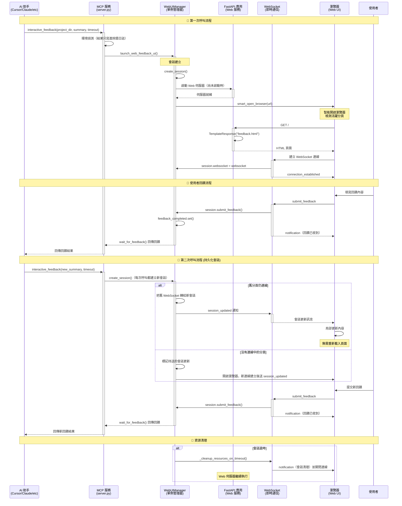

## 🚀 第一次呼叫詳細流程

### 1. AI 助手發起呼叫

**MCP 工具呼叫格式**：
```python
# AI 助手通過 MCP 協議調用
result = await interactive_feedback(
    project_directory="./my-project",
    summary="我已完成了功能 X 的實現，請檢查代碼品質和邏輯正確性。主要變更包括：\n1. 新增錯誤處理機制\n2. 優化性能瓶頸\n3. 增加單元測試覆蓋率",
    timeout=600  # 10 分鐘超時
)
```

**參數說明**：
- `project_directory`: 專案根目錄，用於上下文顯示
- `summary`: AI 工作摘要，向使用者說明已完成的工作
- `timeout`: 等待使用者回饋的逾時時間（秒）

### 2. MCP 服務處理流程

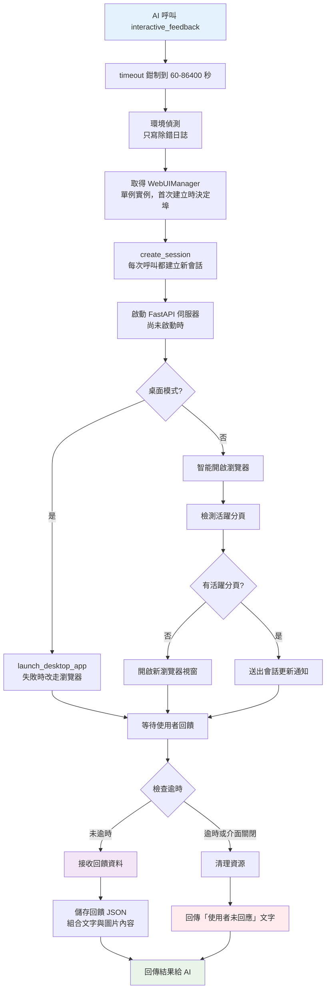

**關鍵步驟詳解**：

#### 2.1 環境檢測與適配
- `is_remote_environment()`（`server.py`）依序檢查：WSL 一律不算遠端；`SSH_CONNECTION`、`SSH_CLIENT`、`SSH_TTY`；`REMOTE_CONTAINERS`、`CODESPACES`；`/.dockerenv`；Windows 的 `SESSIONNAME` 含 `RDP`；Linux 沒有 `DISPLAY`。結果只寫進除錯日誌與 `get_system_info` 的輸出，不改變任何行為，也不會建立 SSH 隧道。
- `is_wsl_environment()`（`web/utils/browser.py`）只在 Linux 上可能為真：`/proc/version` 含 `microsoft` 或 `wsl`、設了 `WSL_DISTRO_NAME`／`WSL_INTEROP`／`WSLENV`、或存在 `/mnt/c` 等 WSL 路徑。
- 開啟瀏覽器（`smart_browser_open()`）：桌面模式不開；WSL 依序試 `cmd.exe /c start`、`powershell.exe Start-Process`、`wslview`；其他環境用 Python 的 `webbrowser.open`。開不了時在 stderr 印出網址，請使用者手動開啟。

#### 2.2 智能會話管理
`WebUIManager.create_session(project_directory, summary)` 每次呼叫都建立新的 `WebFeedbackSession` 並設為目前會話：
- 舊會話若是「已提交」，推進為「已完成」，並留在 `sessions` 字典供 `/api/all-sessions` 查詢
- 舊會話有 WebSocket 連線時，把連線直接轉給新會話，之後由 `smart_open_browser()` 送出 `session_updated`
- 沒有舊連線時設定 `_pending_session_update`，等新 WebSocket 連線建立時送出 `session_updated`
- 回傳新的 `session_id`

#### 2.3 動態埠管理
埠在 `WebUIManager` 初始化時決定：
- `MCP_WEB_PORT=0`：綁定埠 0，由系統分配可用埠
- 其他情況以 `MCP_WEB_PORT`（1024-65535，無效時用 8765）或預設 8765 為偏好埠，交給 `PortManager.find_free_port_enhanced()`：偏好埠可用就用；被本專案或 uvicorn/fastapi 的 Python 行程佔用時先嘗試結束它；否則往上找最多 100 個埠，再往下找；都找不到時拋出 `RuntimeError`

### 3. Web UI 連線建立與初始化

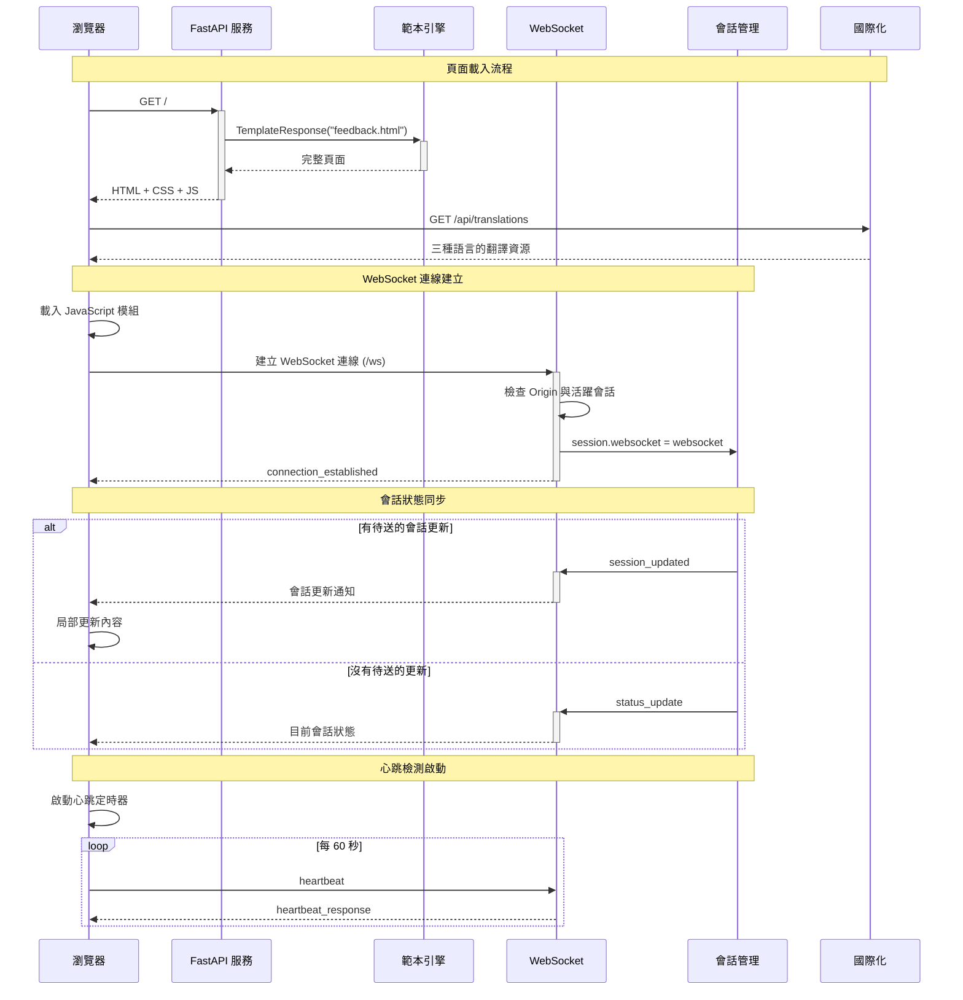

**連線建立關鍵步驟**：

#### 3.1 頁面渲染
`GET /`（`web/routes/main_routes.py` 的 `index()`）沒有活躍會話時渲染 `index.html`；有活躍會話時讀取使用者的版面設定（`load_user_layout_settings()`），以 `session_id`、`project_directory`、`summary`、`title`、`version`、`has_session`、`layout_mode` 渲染 `feedback.html`。翻譯不在伺服器端套用，由前端的 `i18n.js` 從 `/api/translations` 載入。

#### 3.2 WebSocket 連線處理
`/ws`（`websocket_endpoint()`）的處理順序：
1. Origin 不受信任時以代碼 4003 關閉；沒有活躍會話時以代碼 4004 關閉
2. 接受連線，`session.websocket = websocket`（取代舊連線），呼叫 `session.on_client_connected()`
3. 送出 `connection_established`；有 `_pending_session_update` 時接著送 `session_updated` 並清除標記，否則送 `status_update`
4. 迴圈讀取文字訊息並交給 `handle_websocket_message()`；會話已切換或連線不符時結束迴圈
5. 斷線時若這仍是會話登記的連線，清掉 `session.websocket` 並呼叫 `session.on_client_disconnected()` 啟動斷線寬限計時

## 🔄 多次循環呼叫機制

### 持久化會話架構

MCP Feedback Enhanced 的核心創新在於**持久化會話架構**，支援 AI 助手進行多次循環呼叫而無需重新建立連線。

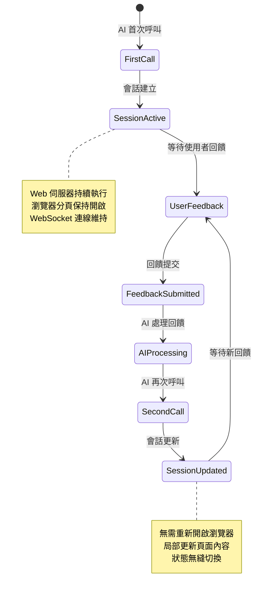

### 第二次呼叫流程

#### 1. AI 助手再次呼叫
```python
# AI 根據用戶回饋進行調整後再次調用
result = await interactive_feedback(
    project_directory="./my-project",
    summary="根據您的建議，我已修改了錯誤處理邏輯，請再次確認",
    timeout=600
)
```

#### 2. 智能會話切換
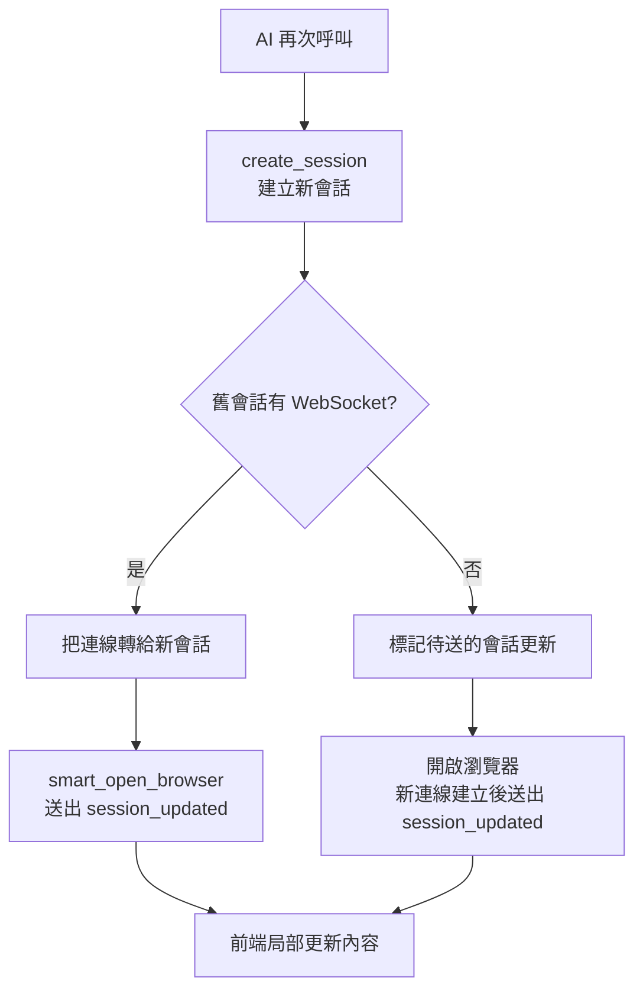

#### 3. 前端無縫更新
前端收到 `action` 為 `new_session_created` 的 `session_updated` 時（`app.js` 的 `_originalHandleSessionUpdated()`）：
1. 播放音效通知（`audioManager.playNotification()`），並送出瀏覽器通知（`notificationManager.notifyNewSession()`）
2. 顯示新會話訊息
3. 500 毫秒後更新 `currentSessionId`、呼叫 `refreshPageContent()` 更新 AI 摘要等內容、`clearFeedback()` 清空表單，並把回饋狀態設回等待中（`FEEDBACK_WAITING`）
4. 有開啟會話逾時時重新啟動計時，最後呼叫 `checkAndStartAutoSubmit()` 檢查自動提交

WebSocket 連線不會重建。

## 🚀 新功能交互流程

### 自動提交功能流程

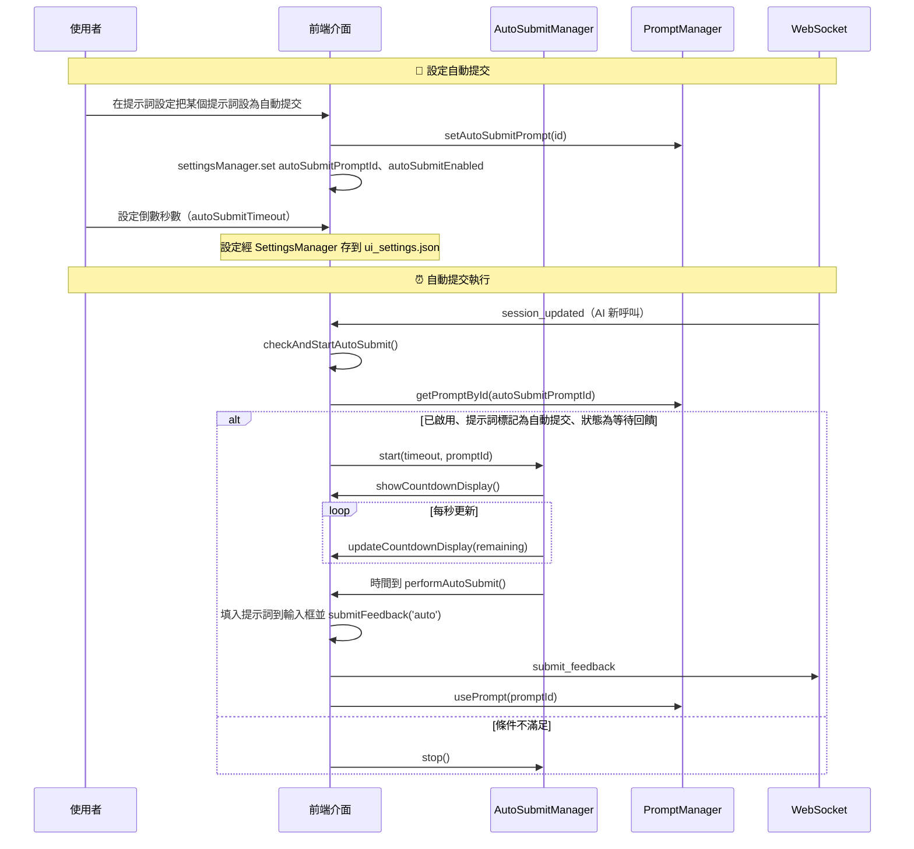

會話歷史裡每則使用者訊息的提交方式（`submission_method`）看這次提交是誰觸發的：只有倒數到期由 `performAutoSubmit()` 送出時記為 `auto`；倒數期間使用者自己按送出或按 Ctrl+Enter，記為 `manual`（`FeedbackApp.collectFeedbackData()`、`recordUserMessage()`）。

### 提示詞管理流程

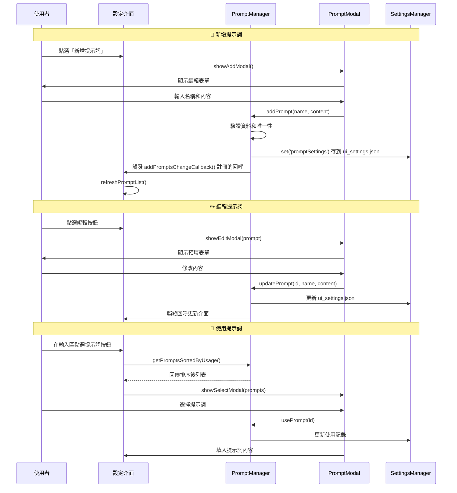

### 會話管理流程（v2.4.3 重構增強）

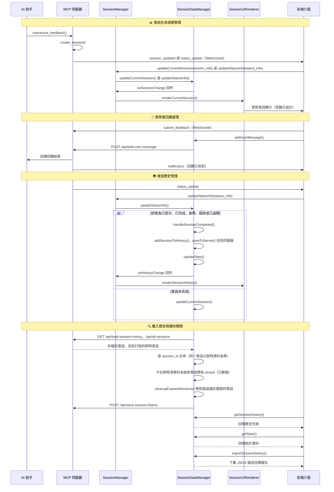

### 音效通知系統流程（v2.4.3 新增）

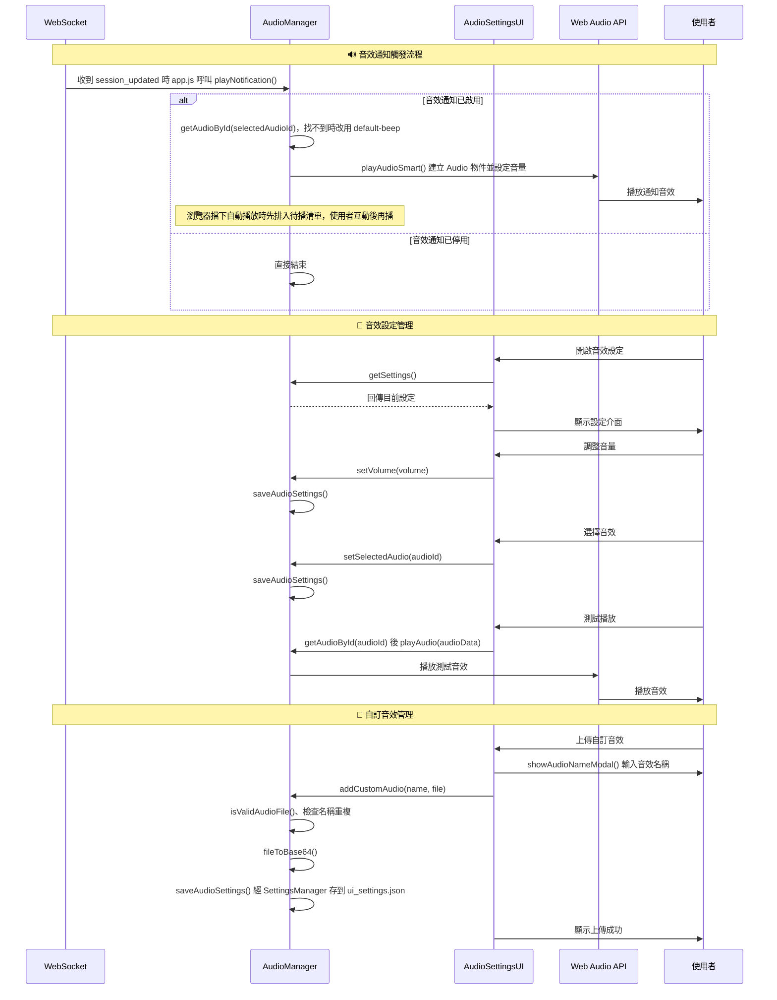

### 智能記憶功能流程（v2.4.3 新增）

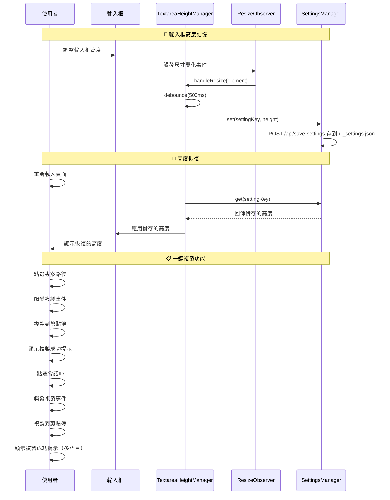

## 📊 狀態同步機制

### WebSocket 訊息類型

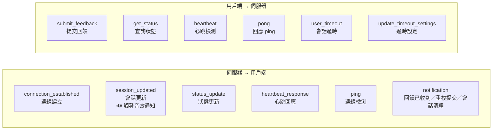

### 狀態轉換圖

前端回饋狀態（`Utils.CONSTANTS`）只有三種：`FEEDBACK_WAITING`（`waiting_for_feedback`）、`FEEDBACK_PROCESSING`（`processing`）、`FEEDBACK_SUBMITTED`（`feedback_submitted`）。自動提交倒數不是獨立狀態，而是在等待狀態下由 `autoSubmitManager` 計時。

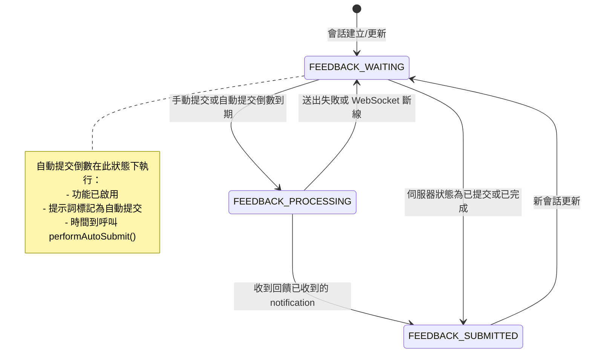

## 🛡️ 錯誤處理和恢復

### 連線斷線處理
重連由 `WebSocketManager`（`websocket-manager.js`）處理，連線狀態經 `onConnectionStatusChange` 交給 `ConnectionMonitor`（`connection-monitor.js`）顯示：

- **關閉碼決定是否重連**（`handleClose()`、`shouldAttemptReconnect()`）：
  - `4004`（沒有活躍會話）：顯示斷線，不重連
  - `1000`（正常關閉，例如伺服器清理會話時以 `reason="會話清理"` 關閉）：不重連
  - 瀏覽器回報離線（`offline` 事件）：不重連；恢復上線（`online` 事件）時把重連次數歸零，1 秒後重新連線
  - 其他關閉碼：重連，直到 `MAX_RECONNECT_ATTEMPTS`（5 次）用完，之後提示「WebSocket 連線失敗，請重新整理頁面重試」
- **延遲**：指數退避，`DEFAULT_RECONNECT_DELAY`（1000 毫秒）× 2^(第 N 次 − 1)，加上 0–1 秒隨機抖動，最多 30 秒
- **連線成功**（`handleOpen()`）：重連次數與延遲歸零，啟動心跳並送出 `get_status` 取得目前狀態
- **心跳**：連線期間每 `DEFAULT_HEARTBEAT_FREQUENCY`（60000 毫秒）送一次 `{type: 'heartbeat', timestamp}`；收到 `heartbeat_response` 時，`ConnectionMonitor` 以送出到收到的時間差計算延遲
- **前端回饋狀態**：斷線時若正處於 `FEEDBACK_PROCESSING`，`FeedbackApp.handleWebSocketClose()` 把它設回 `FEEDBACK_WAITING`，避免卡在送出中

**連線狀態顯示**（`ConnectionMonitor`）：
- 右上角狀態文字「重新連線中... (第N次)」的 N 是這次斷線後的重連次數（`reconnectAttempt`），恢復連線時歸零
- 統計面板的「重新連線」是整頁累計的重連次數（`reconnectCount`），只有重新載入頁面才歸零
- 「連線時間」在連線期間每秒更新；斷線時停止並顯示 `--:--`，重連成功後從 0 起算

伺服器端另有斷線寬限：連線中斷後若在 `CLIENT_DISCONNECT_GRACE_SECONDS`（75 秒）內沒有重新連上，視為使用者關閉介面並結束等待（`WebFeedbackSession.on_client_disconnected()`）。

### 逾時處理
`WebFeedbackSession.wait_for_feedback(timeout)` 在執行緒中等待 `feedback_completed`，實際等待時間比 `timeout` 提早一點結束（超過 30 秒提早 5 秒，否則提早 1 秒，最少 1 秒），避免與 MCP 層的逾時競爭：
- 收到回饋：回傳 `{"interactive_feedback", "images", "settings"}`
- 逾時、使用者設定的會話逾時到期、或斷線寬限到期（視為關閉介面）：清理資源後拋出 `TimeoutError`

`interactive_feedback` 接到 `TimeoutError` 時不當成錯誤，回傳「使用者未回應」的文字，要求 AI 結束任務、不要再次呼叫本工具。

## 🎯 效能優化

### 連線重用
- **WebSocket 連線保持**: 避免重複建立連線
- **會話狀態繼承**: 新會話繼承舊會話的連線
- **智能瀏覽器開啟**: 檢測活躍分頁，避免重複開啟

### 資源管理
- **自動清理機制**: 逾時會話自動清理
- **記憶體優化**: 單一活躍會話模式
- **行程管理**: 優雅的行程啟動和關閉

## 🔒 安全性考量

### 資料安全
- **本機綁定**: 伺服器只綁定 127.0.0.1，減少攻擊面
- **輸入驗證**: 嚴格的參數類型檢查和資料清理
- **檔案上傳安全**: 圖片格式驗證和大小限制
- **命令執行**: 已於 v2.6.1 移除，不再提供

### 網路安全
- **WebSocket 驗證**: 連線來源驗證
- **跨來源控制**: 沒有 CORS 中介層；非 GET/HEAD/OPTIONS 的 `/api/*` 檢查 Origin 並要求 `application/json`
- **逾時保護**: 防止長時間佔用資源
- **錯誤訊息過濾**: 避免敏感資訊洩露

## 🚀 效能優化總結

### 連線重用優勢
- **減少啟動時間**: Web 伺服器啟動後持續執行，之後的呼叫不必重新啟動伺服器與瀏覽器
- **單一活躍會話**: 同一時間只有一個目前會話
- **提升使用者體驗**: 無縫會話切換，保持操作狀態
- **減少網路開銷**: WebSocket 連線保持和重用

### 資源管理效率
- **智能清理**: 自動檢測和清理過期資源
- **動態埠分配**: 避免埠衝突，支援並行開發
- **錯誤恢復**: 優雅的錯誤處理和自動重連
- **跨平台適配**: WSL 中改用 Windows 瀏覽器開啟介面，其他環境用 Python 的 `webbrowser`

---

## 📚 相關文件

- **[系統架構總覽](./system-overview.md)** - 了解整體架構設計理念和技術棧
- **[元件詳細說明](./component-details.md)** - 深入了解各層元件的具體實作
- **[API 參考文件](./api-reference.md)** - 完整的 API 端點和參數說明
- **[部署指南](./deployment-guide.md)** - 環境設定和部署最佳實踐
