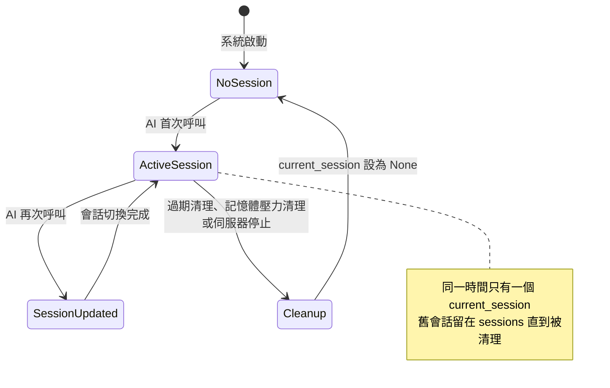
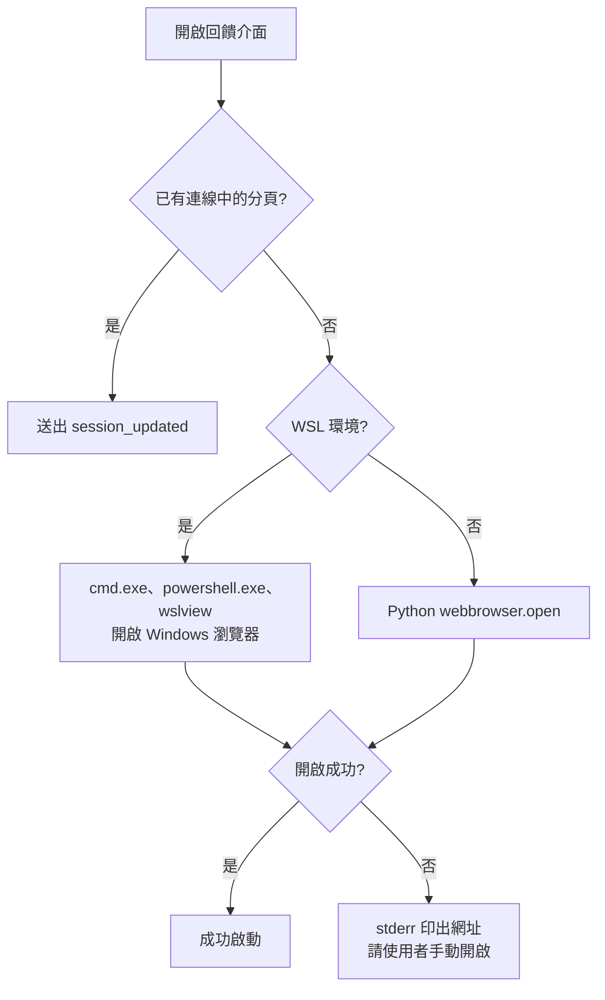
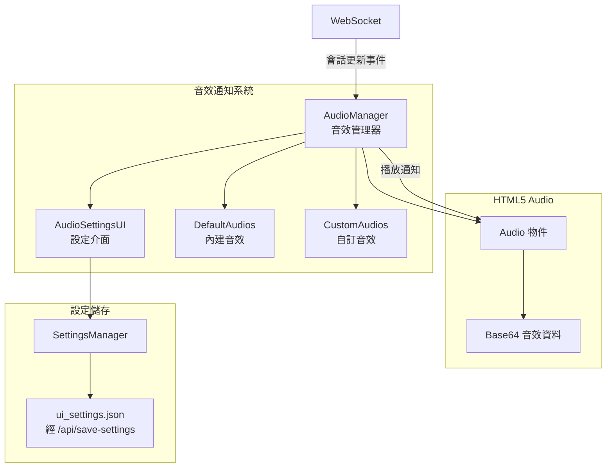
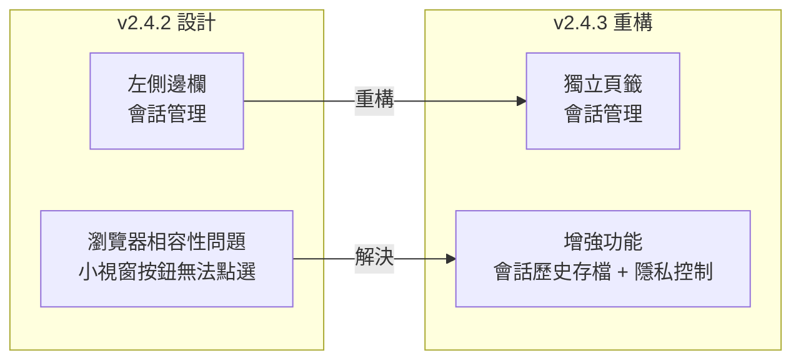
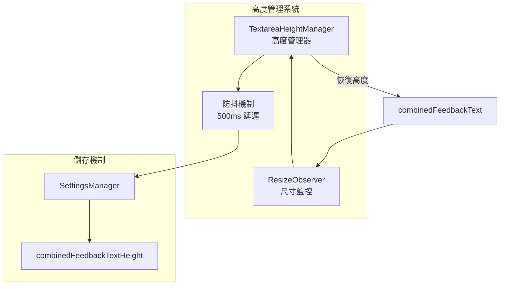
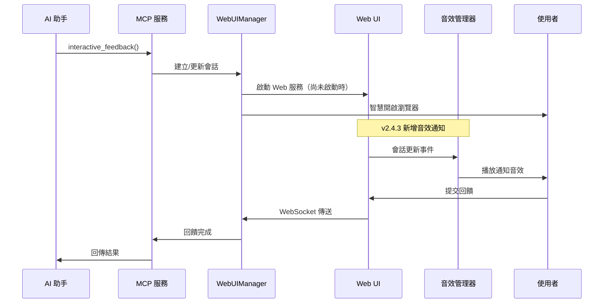
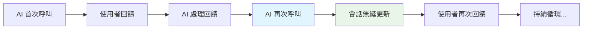

# 系統架構總覽

## 🏗️ 整體架構設計

MCP Feedback Enhanced 採用**單一活躍會話 + 持久化 Web UI**的創新架構設計，達成 AI 助手與使用者之間的高效、無縫互動體驗。

### 核心設計理念

- **Web UI 加桌面模式**：介面一律由 FastAPI 提供的 Web 頁面呈現；預設用瀏覽器開啟，`MCP_DESKTOP_MODE=true` 時改用 Tauri 打包的桌面殼載入同一個頁面，桌面殼啟動失敗時自動改回瀏覽器
- **四層架構設計**：清晰的層次分離，便於維護和擴充
- **環境適應**：WSL 中改用 Windows 瀏覽器開啟介面；SSH 等遠端環境只偵測並寫進除錯日誌，需自行設定埠轉發
- **單一活躍會話**：同一時間只有一個 `current_session`，每次 AI 呼叫建立新會話並取代它；舊會話留在 `sessions` 字典直到被清理
- **模組化設計**：每層職責明確，支援獨立開發和測試

### 技術棧概覽

**後端技術**：
- Python 3.11+ (核心語言)
- FastMCP 4.0+ / MCP Python SDK 2.x (MCP 協定實作)
- FastAPI 0.115+ (Web 框架)
- uvicorn 0.30+ (ASGI 伺服器)
- WebSocket (即時通訊)

**前端技術**：
- HTML5 + CSS3 (現代化 UI)
- JavaScript ES6+ (模組化架構)
- WebSocket API (雙向通訊)
- HTML5 Audio（`new Audio()`，音效通知系統）
- localStorage API (瀏覽器通知設定)
- ResizeObserver API (元素尺寸監控)
- 響應式設計 (多裝置支援)

**開發工具**：
- pytest + pytest-asyncio + pytest-timeout + pytest-cov (測試框架)
- Ruff (lint 與格式化) + mypy (型別檢查)：`Tests` workflow 在 ubuntu 執行 `ruff check`、`ruff format --check`、`mypy`
- pre-commit (提交檢查)：一般檔案檢查加上 Ruff v0.17.2 的 `ruff-check`、`ruff-format`；mypy hook 在設定檔中註解停用
- uv (依賴管理)

### 系統整體架構圖


圖中的連線依據：`server.py` 以 `mcp.run()` 啟動並經 `launch_web_feedback_ui()` 交給 `WebUIManager`；`WebUIManager` 在建構時以 `PortManager` 決定埠、掛上 `memory_monitor`，並以背景執行緒跑 uvicorn；`/ws` 端點與 HTTP API 都在 `web/routes/main_routes.py`；提示詞、音效、自動提交與輸入框高度都經 `SettingsManager` 存到 `/api/save-settings`，會話歷史經 `/api/load-session-history`、`/api/save-session-history` 讀寫；`i18n.py` 在後端只有 `error_handler.py` 使用，介面翻譯由前端從 `/api/translations` 載入；`resource_manager.py` 提供儲存回饋 JSON 用的暫存檔。

## 🎯 核心設計理念

### 1. Web UI 與桌面模式

**同一套 Web 介面**：
- 介面一律是 FastAPI 提供的 Web 頁面，瀏覽器模式與桌面模式顯示同一個頁面
- 預設以瀏覽器開啟，支援具備現代瀏覽器的環境；SSH Remote 需自行設定埠轉發，WSL 改用 Windows 瀏覽器開啟

**Tauri 桌面模式**（`MCP_DESKTOP_MODE=true`）：
- `desktop_app/desktop_app.py` 依平台從 `desktop_release/` 找出打包好的 Tauri 執行檔（Windows `.exe`、macOS arm64／intel、Linux），以環境變數 `MCP_WEB_URL` 傳入 Web 服務網址後啟動
- 桌面殼（`src-tauri/`）讀取 `MCP_WEB_URL` 並讓主視窗載入該網址
- 桌面殼啟動失敗時，本行程改用瀏覽器開啟並在 stderr 印出網址；重啟 MCP 伺服器才會再試桌面

### 2. 四層架構設計

**第一層 - MCP 服務層**：
- 實作 MCP 協定標準
- 提供 `interactive_feedback` 核心工具
- 統一的國際化和除錯支援
- 錯誤處理和日誌記錄

**第二層 - Web UI 管理層**：
- 單例模式的 WebUIManager
- 會話生命週期管理
- 資料模型和狀態管理
- 瀏覽器智慧控制

**第三層 - Web 服務層**：
- FastAPI 高效能 Web 框架
- RESTful API 和 WebSocket 支援
- 路由處理和中介軟體
- 靜態資源服務

**第四層 - 前端互動層**：
- 模組化 JavaScript 架構
- 響應式 HTML/CSS 設計
- 即時 WebSocket 通訊
- 豐富的使用者互動功能
- **提示詞管理系統**：常用提示詞的 CRUD 操作和快速選擇
- **會話管理功能**：會話歷史追蹤和統計分析（v2.4.3 重構增強）
- **自動提交機制**：倒數計時器和自動回饋提交
- **音效通知系統**：智慧音效提醒和自訂音效管理（v2.4.3 新增）
- **智慧記憶功能**：輸入框高度記憶和一鍵複製（v2.4.3 新增）

### 3. 單一活躍會話模式


### 4. 持久化 Web UI 架構

**跨呼叫保留的部分**：
- **不重複開瀏覽器**: `_check_active_tabs()` 判斷已有連線中的分頁時不開新視窗，改送 `session_updated`
- **沿用 WebSocket 連線**: `create_session()` 把舊會話的 WebSocket 直接轉給新會話
- **前端狀態切換**: 收到新會話時，前端回饋狀態回到 `FEEDBACK_WAITING`
- **局部更新**: 以 `GET /api/current-session` 更新 AI 摘要與專案資訊，不重新載入頁面；輸入框與已貼上的圖片會清空（`clearFeedback()`）

**跨呼叫不保留的部分**：
- 每次 AI 呼叫都是新的會話，回饋、圖片與會話狀態不會延續到下一次呼叫
- 跨呼叫保留的是頁面本身、WebSocket 連線、`ui_settings.json` 的設定與 `session_history.json` 的會話歷史
- 舊會話由過期清理與記憶體壓力清理移除（見「效能特性與優化」）

### 5. 國際化與本地化

**多語言支援**：
- 繁體中文、簡體中文、英文
- 網頁介面語言：`MCP_LANGUAGE` > `ui_settings.json` 的 `language` > 瀏覽器語言 > `zh-TW`；回饋頁與等待頁相同
- `MCP_LANGUAGE` 只接受 `zh-TW`、`zh-CN`、`en`；設定時介面切換語言只在目前頁面有效，不存檔；沒設定時切換結果存進 `ui_settings.json`
- 動態語言切換，不需重新載入頁面；回給 AI 的錯誤訊息語言另由後端 `i18n.py` 決定（`MCP_LANGUAGE` > `LANG` 等環境變數 > 系統 locale > `zh-TW`）

**本地化特性**：
- 會話卡片與列表的時間、提示詞的建立／使用時間、自訂音效的建立日期，以 `toLocaleTimeString`／`toLocaleDateString` 依介面語言格式化（`TimeUtils.formatTimestamp()`）；其中提示詞與音效的日期經 `timestampHTML()` 產生，切換語言時重新格式化；會話詳情彈出視窗的時間用固定的 `YYYY/MM/DD HH:mm:ss` 格式，不分語言
- 後端錯誤訊息與錯誤上下文前綴依語言分開（`ErrorHandler` 的 `_ERROR_MESSAGES`、`_CONTEXT_LABELS`）
- 版面與字型不分語言，三種語言共用同一套 HTML 與 CSS

### 6. 智慧環境偵測


## 🔧 技術亮點

### 1. 單一活躍會話架構

**WebUIManager 的會話欄位**（`web/main.py`）：
```python
self.current_session: WebFeedbackSession | None = None
self.sessions: dict[str, WebFeedbackSession] = {}  # 保留用於向後兼容
```

`current_session` 是唯一的活躍會話。每次 AI 呼叫都由 `create_session()` 建立新會話並取代它；舊會話留在 `sessions`，供 `/api/all-sessions` 查詢，直到被過期清理或記憶體壓力清理移除。

**會話生命週期管理**：
- 每次呼叫建立新會話；舊會話若已提交回饋，推進為已完成
- 逾時、使用者設定的會話逾時、斷線寬限到期都會經 `_cleanup_resources_enhanced()` 清理資源；過期會話另由會話的自動清理定時器與 `cleanup_expired_sessions()` 清除
- 伺服器不儲存會話狀態；會話歷史由前端存到 `session_history.json`
- 提交與逾時的判定以 `_outcome_lock` 保護，同一會話重複提交會被忽略

### 2. 智慧環境偵測與適應

**環境偵測**：
- `is_wsl_environment()`：只在 Linux 上可能成立，決定是否改用 Windows 瀏覽器
- `is_remote_environment()`：SSH、Codespaces、Remote Containers、Docker、Windows 遠端桌面、沒有 `DISPLAY` 的 Linux 判定為遠端；結果只寫進除錯日誌與 `get_system_info`，不改變行為

**瀏覽器智慧開啟**：
- **活躍分頁偵測**: 避免重複開啟瀏覽器視窗
- **跨平台支援**: Windows, macOS, Linux 自動適應
- **WSL 處理**: 依序用 `cmd.exe`、`powershell.exe`、`wslview` 開啟 Windows 瀏覽器
- **開啟失敗**: 在 stderr 印出網址，請使用者手動開啟

### 3. 即時通訊

**WebSocket 雙向通訊**：
- 單一 `/ws` 連線，訊息是以 `type` 區分的 JSON
- 前端每 60 秒送一次心跳
- 斷線後以指數退避自動重連，最多 5 次

**狀態同步**：
- **會話更新通知**: 新會話建立時，有連線就立即送 `session_updated`，沒有連線就等新連線建立後補送
- **完整快照**: `status_update` 每次送出完整的 `status_info`；前端收到新會話後以 `GET /api/current-session` 重新取得內容，沒有增量更新或狀態回滾
- **前端防抖**: `status_update`、`session_updated` 依類型各自防抖 50 毫秒，其他訊息直接處理

### 4. 模組化前端架構

**JavaScript 模組系統**：
```javascript
// 模組化載入順序
vendor/(marked、DOMPurify) → i18n → logger → utils/(dom、time、status) → session/ → prompt/ →
audio/ → notification/ → utils → websocket-manager →
connection-monitor → session-manager → file-upload-manager →
image-handler → settings-manager → ui-manager →
textarea-height-manager → app
```

**功能模組分離**：
- WebSocket 通訊 (websocket-manager.js)
- 連線狀態監控 (connection-monitor.js)
- 圖片處理 (image-handler.js、file-upload-manager.js)
- 設定管理 (settings-manager.js)
- UI 控制 (ui-manager.js)
- 瀏覽器通知 (notification/notification-manager.js、notification-settings.js)
- **提示詞管理模組群組**：
  - prompt-manager.js (核心管理器)
  - prompt-modal.js (編輯彈出視窗)
  - prompt-settings-ui.js (設定介面)
  - prompt-input-buttons.js (快速選擇按鈕)
- **會話管理模組群組（v2.4.3 重構增強）**：
  - session-manager.js (會話控制器)
  - session-data-manager.js (資料管理器，經 HTTP API 讀寫伺服器端歷史)
  - session-ui-renderer.js (UI 渲染器，頁籤化設計)
  - session-details-modal.js (詳情彈出視窗)
- **音效通知模組群組（v2.4.3 新增）**：
  - audio-manager.js (音效管理器)
  - audio-settings-ui.js (音效設定介面)
- **智慧記憶功能（v2.4.3 新增）**：
  - textarea-height-manager.js (輸入框高度管理)
  - 一鍵複製功能整合在各 UI 元件中
- **自動提交功能**：
  - 整合在 app.js 中的 `autoSubmitManager` 物件
  - 與提示詞管理和設定管理的深度整合

## 📊 效能特性與優化

### 資源使用

**記憶體管理**：
- **單一活躍會話**: 同一時間只有一個 `current_session`；舊會話留在 `sessions` 字典，直到被過期清理或記憶體壓力清理移除。沒有量測過的記憶體節省比例
- **記憶體監控**: `MemoryMonitor` 每 30 秒取樣，系統記憶體使用率達 90% 時清理過期會話，達 95% 時強制清理會話
- **暫存檔清理**: `ResourceManager` 每 300 秒清理最後修改超過 1 小時的已登記暫存檔

**網路**：
- **連線沿用**: 同一個分頁在多次 AI 呼叫間沿用同一條 WebSocket 連線，新會話建立時直接轉給新會話
- **Gzip 壓縮**: 回應超過 `MCP_GZIP_MIN_SIZE`（預設 1000 位元組）時，以 `MCP_GZIP_LEVEL`（預設 6）壓縮
- **快取標頭**: `/static/` 預設快取 3600 秒；`/api/` 預設不加快取標頭（`MCP_API_CACHE_AGE=0`），翻譯經 `/api/translations` 取得，因此預設也不快取

**啟動**：
- 所有 JavaScript 模組都在 `feedback.html` 以 `<script>` 標籤一次載入，沒有按需載入
- 伺服器啟動時以 `asyncio.gather` 執行非同步初始化任務（目前只有 i18n 預載）
- 伺服器啟動失敗最多重試 5 次；埠在啟動時被佔用則改找可用埠

### 使用者體驗

- **不重新載入頁面**: 收到新會話的 `session_updated` 後局部更新 AI 摘要與表單
- **快捷鍵**: Ctrl（macOS 為 ⌘）+ Enter 送出回饋，Ctrl（⌘）+ I 聚焦輸入框
- **自動提交**: 倒數到期時把設為自動提交的提示詞填入輸入框並送出
- **狀態指示**: 右上角顯示連線狀態，統計面板顯示連線時間、重連次數、延遲與會話資訊

### 可靠性

- **桌面殼回退**: 桌面殼啟動失敗時本行程改用瀏覽器
- **自動重連**: WebSocket 斷線後以指數退避重連，最多 5 次
- **逾時保護**: `timeout` 鉗制在 60–86400 秒；前端斷線超過 75 秒視為使用者關閉介面並結束等待
- **併發控制**: 提交與逾時判定以 `_outcome_lock` 保護，同一會話重複提交會被忽略
- **錯誤處理**: `ErrorHandler.log_error_with_context()` 產生錯誤 ID 並寫進除錯日誌；回給 AI 的是 `format_user_error()` 產生的使用者可讀訊息，不會把例外拋給 MCP 用戶端

## 🆕 v2.4.3 版本新功能架構

### 1. 音效通知系統架構

**系統組成**：


**核心特性**：
- **內建音效**: 經典提示音、通知鈴聲、輕柔鐘聲
- **自訂音效**: 支援 MP3、WAV、OGG 格式上傳
- **音量控制**: 0-100% 可調節音量
- **測試播放**: 即時測試音效效果
- **設定持久化**: 音效偏好自動儲存

### 2. 會話管理重構架構

**從側邊欄到頁籤的遷移**：


**新增功能模組**：
- **session-ui-renderer.js**: 專門的 UI 渲染器
- **session-details-modal.js**: 會話詳情彈出視窗
- **伺服器端歷史儲存**: 存在 `session_history.json`，儲存期限可選 24、72、168、720 小時（預設 72）
- **隱私控制**: 三級使用者訊息記錄設定
- **資料管理**: 匯出和清理功能

### 3. 智慧記憶功能架構

**輸入框高度管理**：


**一鍵複製功能**：
- **專案路徑、會話 ID**: 會話頁籤中點選即複製（`Utils.copyToClipboard()`），成功或失敗都顯示翻譯過的提示
- **使用者內容**: 工作區的「複製使用者內容」按鈕複製輸入框文字（`copyUserFeedback()`）
- **目前會話**: 會話頁籤的「複製會話內容」「複製使用者內容」按鈕
- **會話詳情**: 詳情彈出視窗的「複製摘要」「複製訊息內容」

## 🔄 核心工作流程

### AI 助手呼叫流程（v2.4.3 增強）


### 多次循環呼叫


## 🔍 安全性考量

### 資料安全

**輸入處理**：
- MCP 工具參數：`timeout` 鉗制在 60–86400 秒，無法解析時用 600；`project_directory` 不存在時改用伺服器的工作目錄
- 沒有資料庫，因此沒有 SQL 注入面
- XSS：AI 摘要以 marked 轉換後經 DOMPurify 過濾；會話歷史、自訂音效名稱等內容以 `escapeHtml` 轉義後再插入頁面
- 圖片上傳：前端只收 `image/*` 類型、最多 10 張，大小上限可在設定中選擇；後端依 `image_size_limit` 略過超過上限的圖片並解碼 Base64

**網路安全**：
- 預設只綁定 `127.0.0.1`；沒有認證機制
- `/ws` 與非 GET/HEAD/OPTIONS 的 `/api/*` 請求檢查 Origin；`/api/*` 的寫入請求另外要求 `Content-Type: application/json`
- 沒有 CORS 中介層，也沒有加上額外的安全標頭

**資源保護**：
- 記憶體監控與暫存檔定期清理（見上方「資源使用」）
- 沒有檔案系統沙箱或執行時間限制；回饋結果寫到暫存 JSON 檔，由 `ResourceManager` 定期清理

## 🚀 部署與維護

### 環境需求

- Python 3.11 或更高版本（`pyproject.toml` 的 `requires-python`）
- 支援 WebSocket 的現代瀏覽器；瀏覽器不支援 `ResizeObserver` 時，輸入框高度只會載入、不會記住新的高度
- 不需要外部網路：marked 與 DOMPurify 隨套件提供（`static/js/vendor/`），頁面上只有「關於」分頁的 GitHub、Discord 連結指向外部
- 桌面模式需要對應平台的 Tauri 執行檔，套件已附 Windows、macOS（arm64／intel）與 Linux 版本
- 沒有量測過的記憶體或磁碟需求

### 維護特性

**自動化維護**：
- 不寫日誌檔，因此沒有日誌輪轉
- 定期資源清理：`ResourceManager` 每 300 秒清理最後修改超過 1 小時的已登記暫存檔
- 記憶體監控：`MemoryMonitor` 每 30 秒取樣系統記憶體，使用率達 90% 時清理過期會話，達 95% 時強制清理會話
- 沒有健康檢查端點；記憶體、資源與壓縮統計只在程式內部累計，沒有端點或報表輸出

**監控與診斷**：
- 除錯日誌：設定 `MCP_DEBUG=true` 時寫到 stderr
- 錯誤記錄：`ErrorHandler.log_error_with_context()` 為每個錯誤產生錯誤 ID，並把類型、上下文與堆疊寫進除錯日誌；不累計錯誤統計
- 系統資源監控：以 `psutil` 取得系統與本行程的記憶體使用量

---

## 📚 相關文件

- **[元件詳細說明](./component-details.md)** - 深入了解各層元件的具體實作
- **[互動流程文件](./interaction-flows.md)** - 詳細的使用者互動和系統流程
- **[API 參考文件](./api-reference.md)** - 完整的 API 端點和參數說明
- **[部署指南](./deployment-guide.md)** - 環境設定和部署最佳實踐
