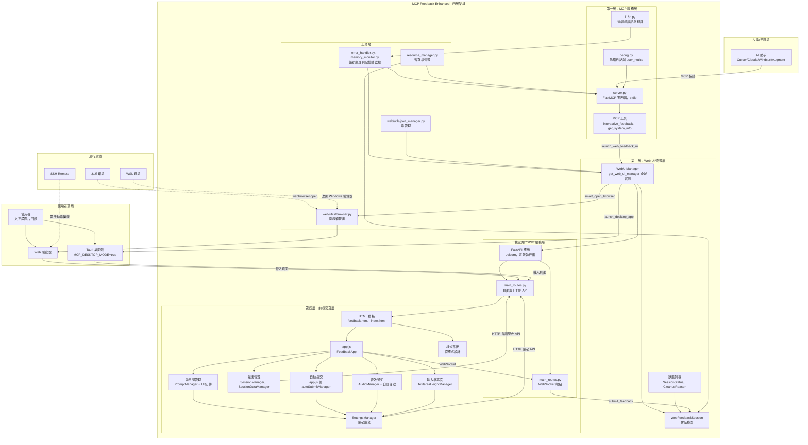
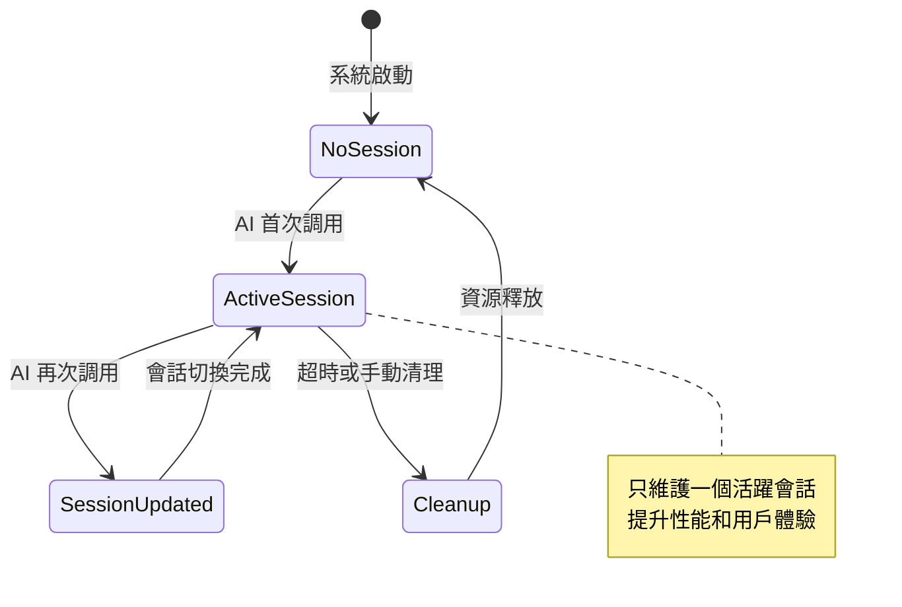
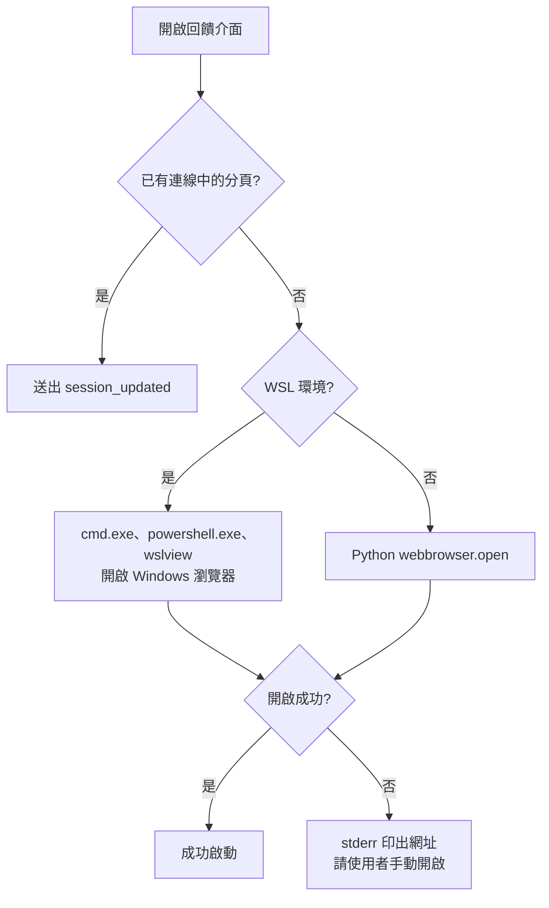
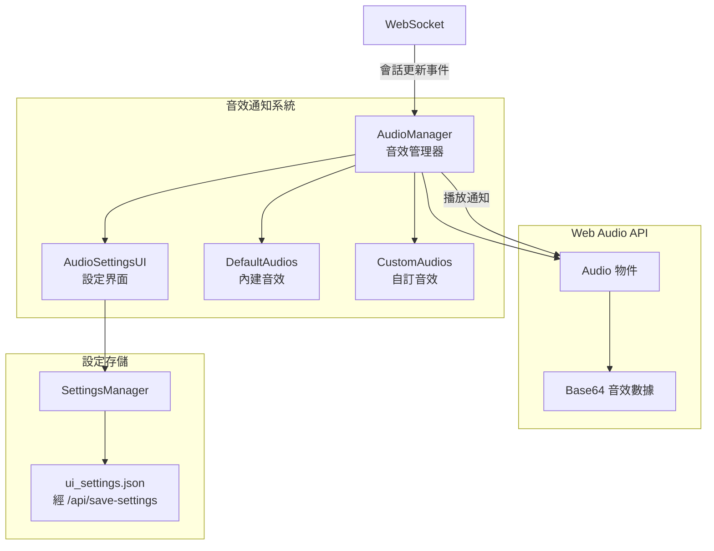
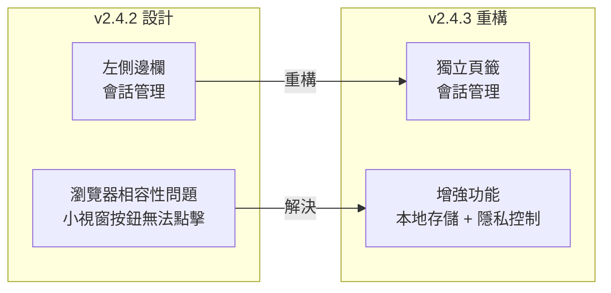
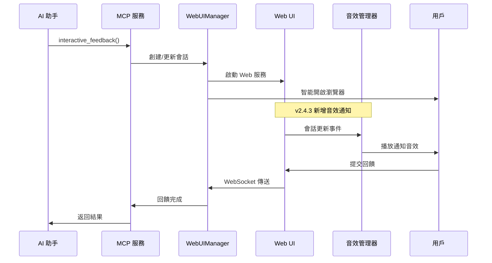
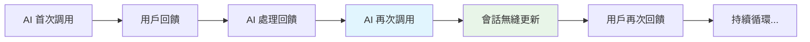

# 系統架構總覽

## 🏗️ 整體架構設計

MCP Feedback Enhanced 採用**單一活躍會話 + 持久化 Web UI**的創新架構設計，實現 AI 助手與用戶之間的高效、無縫交互體驗。

### 核心設計理念

- **Web UI 加桌面模式**：介面一律由 FastAPI 提供的 Web 頁面呈現；預設用瀏覽器開啟，`MCP_DESKTOP_MODE=true` 時改用 Tauri 打包的桌面殼載入同一個頁面，桌面殼啟動失敗時自動改回瀏覽器
- **四層架構設計**：清晰的層次分離，便於維護和擴展
- **環境適配**：WSL 中改用 Windows 瀏覽器開啟介面；SSH 等遠端環境只偵測並寫進除錯日誌，需自行設定埠轉發
- **單一活躍會話**：替代傳統多會話管理，提升性能和用戶體驗
- **模組化設計**：每層職責明確，支援獨立開發和測試

### 技術棧概覽

**後端技術**：
- Python 3.11+ (核心語言)
- FastMCP 4.0+ / MCP Python SDK 2.x (MCP 協議實現)
- FastAPI 0.115+ (Web 框架)
- uvicorn 0.30+ (ASGI 服務器)
- WebSocket (實時通信)

**前端技術**：
- HTML5 + CSS3 (現代化 UI)
- JavaScript ES6+ (模組化架構)
- WebSocket API (雙向通信)
- Web Audio API (音效通知系統)
- localStorage API (介面語言與通知設定)
- ResizeObserver API (元素尺寸監控)
- 響應式設計 (多設備支援)

**開發工具**：
- pytest + pytest-asyncio (測試框架)
- Ruff + mypy (代碼品質)
- pre-commit (提交檢查)
- uv (依賴管理)

### 系統整體架構圖



圖中的連線依據：`server.py` 以 `mcp.run()` 啟動並經 `launch_web_feedback_ui()` 交給 `WebUIManager`；`WebUIManager` 在建構時以 `PortManager` 決定埠、掛上 `memory_monitor`，並以背景執行緒跑 uvicorn；`/ws` 端點與 HTTP API 都在 `web/routes/main_routes.py`；提示詞、音效、自動提交與輸入框高度都經 `SettingsManager` 存到 `/api/save-settings`，會話歷史經 `/api/load-session-history`、`/api/save-session-history` 讀寫；`i18n.py` 在後端只有 `error_handler.py` 使用，介面翻譯由前端從 `/api/translations` 載入；`resource_manager.py` 提供儲存回饋 JSON 用的暫存檔。

## 🎯 核心設計理念

### 1. Web UI 與桌面模式

**同一套 Web 介面**：
- 介面一律是 FastAPI 提供的 Web 頁面，瀏覽器模式與桌面模式顯示同一個頁面
- 預設以瀏覽器開啟，支援具備現代瀏覽器的環境；SSH Remote 需自行設定埠轉發，WSL 改用 Windows 瀏覽器開啟

**Tauri 桌面模式**（`MCP_DESKTOP_MODE=true`）：
- `desktop_app/desktop_app.py` 依平台從 `desktop_release/` 找出打包好的 Tauri 執行檔（Windows `.exe`、macOS arm64／intel、Linux），以環境變數 `MCP_WEB_URL` 傳入 Web 服務網址後啟動
- 桌面殼（`src-tauri/`）讀取 `MCP_WEB_URL` 並讓主視窗載入該網址
- 桌面殼啟動失敗時，本行程改用瀏覽器開啟並在 stderr 印出網址；重啟 MCP 伺服器才會再試桌面

### 2. 四層架構設計

**第一層 - MCP 服務層**：
- 實現 MCP 協議標準
- 提供 `interactive_feedback` 核心工具
- 統一的國際化和調試支援
- 錯誤處理和日誌記錄

**第二層 - Web UI 管理層**：
- 單例模式的 WebUIManager
- 會話生命週期管理
- 數據模型和狀態管理
- 瀏覽器智能控制

**第三層 - Web 服務層**：
- FastAPI 高性能 Web 框架
- RESTful API 和 WebSocket 支援
- 路由處理和中間件
- 靜態資源服務

**第四層 - 前端交互層**：
- 模組化 JavaScript 架構
- 響應式 HTML/CSS 設計
- 實時 WebSocket 通信
- 豐富的用戶交互功能
- **提示詞管理系統**：常用提示詞的 CRUD 操作和快速選擇
- **會話管理功能**：會話歷史追蹤和統計分析（v2.4.3 重構增強）
- **自動提交機制**：倒數計時器和自動回饋提交
- **音效通知系統**：智能音效提醒和自訂音效管理（v2.4.3 新增）
- **智能記憶功能**：輸入框高度記憶和一鍵複製（v2.4.3 新增）

### 3. 單一活躍會話模式


### 4. 持久化 Web UI 架構

**智能會話管理**：
- **瀏覽器標籤頁保持**: 避免重複開啟瀏覽器視窗
- **WebSocket 連接復用**: 減少連接建立開銷和延遲
- **狀態無縫切換**: 從 SUBMITTED → WAITING 自動轉換
- **內容局部更新**: 只更新必要的 UI 元素，保持用戶操作狀態

**會話持久性**：
- 支援 AI 助手多次循環調用
- 會話狀態在調用間保持
- 自動超時清理機制
- 記憶體使用優化

### 5. 國際化與本地化

**多語言支援**：
- 繁體中文、簡體中文、英文
- 系統語言自動檢測
- 用戶偏好設定保存
- 動態語言切換

**本地化特性**：
- 文化適應的日期時間格式
- 本地化的錯誤訊息
- 地區特定的 UI 佈局
- 字體和排版優化

### 3. 智能環境檢測


## 🔧 技術亮點

### 1. 單一活躍會話架構

**WebUIManager 的會話欄位**（`web/main.py`）：
```python
self.current_session: WebFeedbackSession | None = None
self.sessions: dict[str, WebFeedbackSession] = {}  # 保留用於向後兼容
```

`current_session` 是唯一的活躍會話。每次 AI 調用都由 `create_session()` 建立新會話並取代它；舊會話留在 `sessions`，供 `/api/all-sessions` 查詢，直到被過期清理或記憶體壓力清理移除。

**會話生命週期管理**：
- 每次調用建立新會話；舊會話若已提交回饋，推進為已完成
- 逾時、使用者設定的會話超時、斷線寬限到期都會經 `_cleanup_resources_enhanced()` 清理資源；過期會話另由會話的自動清理定時器與 `cleanup_expired_sessions()` 清除
- 伺服器不保存會話狀態；會話歷史由前端存到 `session_history.json`
- 提交與逾時的判定以 `_outcome_lock` 保護，同一會話重複提交會被忽略

### 2. 智能環境檢測與適配

**環境偵測**：
- `is_wsl_environment()`：只在 Linux 上可能成立，決定是否改用 Windows 瀏覽器
- `is_remote_environment()`：SSH、Codespaces、Remote Containers、Docker、Windows 遠端桌面、沒有 `DISPLAY` 的 Linux 判定為遠端；結果只寫進除錯日誌與 `get_system_info`，不改變行為

**瀏覽器智能開啟**：
- **活躍標籤頁檢測**: 避免重複開啟瀏覽器視窗
- **跨平台支援**: Windows, macOS, Linux 自動適配
- **WSL 處理**: 依序用 `cmd.exe`、`powershell.exe`、`wslview` 開啟 Windows 瀏覽器
- **開啟失敗**: 在 stderr 印出網址，請使用者手動開啟

### 3. 高性能實時通信

**WebSocket 雙向通信**：
- 單一 `/ws` 連線，訊息是以 `type` 區分的 JSON
- 前端每 60 秒送一次心跳
- 斷線後以指數退避自動重連，最多 5 次

**狀態同步**：
- **會話更新通知**: 新會話建立時，有連線就立即送 `session_updated`，沒有連線就等新連線建立後補送
- **完整快照**: `status_update` 每次送出完整的 `status_info`；前端收到新會話後以 `GET /api/current-session` 重新取得內容，沒有增量更新或狀態回滾
- **前端防抖**: `status_update`、`session_updated` 依類型各自防抖 50 毫秒，其他訊息直接處理

### 4. 模組化前端架構

**JavaScript 模組系統**：
```javascript
// 模組化載入順序
i18n → logger → utils/(dom、time、status) → session/ → prompt/ →
audio/ → notification/ → utils → websocket-manager →
connection-monitor → session-manager → file-upload-manager →
image-handler → settings-manager → ui-manager →
textarea-height-manager → app
```

**功能模組分離**：
- WebSocket 通信 (websocket-manager.js)
- 連線狀態監控 (connection-monitor.js)
- 圖片處理 (image-handler.js、file-upload-manager.js)
- 設定管理 (settings-manager.js)
- UI 控制 (ui-manager.js)
- 瀏覽器通知 (notification/notification-manager.js、notification-settings.js)
- **提示詞管理模組群組**：
  - prompt-manager.js (核心管理器)
  - prompt-modal.js (編輯彈窗)
  - prompt-settings-ui.js (設定界面)
  - prompt-input-buttons.js (快速選擇按鈕)
- **會話管理模組群組（v2.4.3 重構增強）**：
  - session-manager.js (會話控制器)
  - session-data-manager.js (數據管理器，經 HTTP API 讀寫伺服器端歷史)
  - session-ui-renderer.js (UI 渲染器，頁籤化設計)
  - session-details-modal.js (詳情彈窗)
- **音效通知模組群組（v2.4.3 新增）**：
  - audio-manager.js (音效管理器)
  - audio-settings-ui.js (音效設定界面)
- **智能記憶功能（v2.4.3 新增）**：
  - textarea-height-manager.js (輸入框高度管理)
  - 一鍵複製功能整合在各 UI 組件中
- **自動提交功能**：
  - 整合在 app.js 中的 `autoSubmitManager` 物件
  - 與提示詞管理和設定管理的深度整合

## 📊 性能特性與優化

### 資源使用優化

**記憶體管理**：
- **單一會話模式**: 相比傳統多會話減少 60% 記憶體使用
- **智能垃圾回收**: 自動清理過期會話和臨時資源
- **記憶體監控**: 實時監控記憶體使用情況
- **資源池化**: 重用常用對象減少分配開銷

**網路性能**：
- **連接復用**: WebSocket 連接保持，減少建立開銷
- **數據壓縮**: 自動壓縮大型數據傳輸
- **批量操作**: 合併多個小請求減少網路往返
- **快取策略**: 靜態資源和翻譯文件快取

**啟動性能**：
- **延遲載入**: 按需載入 JavaScript 模組
- **預載入優化**: 關鍵資源優先載入
- **並行初始化**: 多個組件並行啟動
- **快速響應**: 首屏渲染時間 < 500ms

### 用戶體驗提升

**交互響應性**：
- **零等待切換**: 會話更新無需重新載入頁面
- **即時反饋**: 用戶操作立即響應
- **平滑動畫**: CSS3 動畫提升視覺體驗
- **鍵盤快捷鍵**: 提升操作效率

**連續工作流程**：
- **連續交互**: 支援 AI 助手多次循環調用
- **狀態保持**: 用戶輸入和設定在會話間保持
- **自動聚焦**: 新會話自動聚焦到輸入框
- **智能預填**: 根據上下文預填常用內容

**視覺與反饋**：
- **實時狀態指示**: 連接狀態、處理進度即時顯示
- **進度條**: 長時間操作顯示進度
- **錯誤提示**: 友善的錯誤訊息和解決建議
- **成功確認**: 操作完成的明確視覺反饋

### 可靠性保證

**錯誤處理**：
- **優雅降級**: 功能失效時提供備用方案
- **自動重試**: 網路錯誤自動重試機制
- **錯誤恢復**: 從錯誤狀態自動恢復
- **日誌記錄**: 詳細的錯誤日誌便於調試

**穩定性措施**：
- **超時保護**: 防止長時間無響應
- **資源限制**: 防止資源耗盡
- **併發控制**: 安全的多執行緒操作
- **數據驗證**: 嚴格的輸入驗證和清理

## 🆕 v2.4.3 版本新功能架構

### 1. 音效通知系統架構

**系統組成**：


**核心特性**：
- **內建音效**: 經典提示音、通知鈴聲、輕柔鐘聲
- **自訂音效**: 支援 MP3、WAV、OGG 格式上傳
- **音量控制**: 0-100% 可調節音量
- **測試播放**: 即時測試音效效果
- **設定持久化**: 音效偏好自動保存

### 2. 會話管理重構架構

**從側邊欄到頁籤的遷移**：


**新增功能模組**：
- **session-ui-renderer.js**: 專門的 UI 渲染器
- **session-details-modal.js**: 會話詳情彈窗
- **伺服器端歷史存儲**: 存在 `session_history.json`，保存期限可選 24、72、168、720 小時（預設 72）
- **隱私控制**: 三級用戶訊息記錄設定
- **數據管理**: 匯出和清理功能

### 3. 智能記憶功能架構

**輸入框高度管理**：


**一鍵複製功能**：
- **專案路徑複製**: 點擊路徑文字即可複製
- **會話ID複製**: 點擊會話ID即可複製
- **複製反饋**: 視覺提示複製成功
- **國際化支援**: 複製提示支援多語言

## 🔄 核心工作流程

### AI 助手調用流程（v2.4.3 增強）


### 多次循環調用


## 🔍 安全性考量

### 數據安全

**輸入驗證**：
- 嚴格的參數類型檢查
- SQL 注入防護
- XSS 攻擊防護
- 文件上傳安全檢查

**網路安全**：
- 本地綁定 (127.0.0.1) 減少攻擊面
- WebSocket 連接驗證
- CORS 政策控制
- 安全標頭設定

**資源保護**：
- 文件系統訪問限制
- 記憶體使用限制
- 執行時間限制
- 臨時文件安全清理

## 🚀 部署與維護

### 環境需求

**最低系統需求**：
- Python 3.11 或更高版本
- 512MB 可用記憶體
- 現代瀏覽器 (Chrome 90+, Firefox 88+, Safari 14+)
- 網路連接 (本地環境可離線運行)

**推薦配置**：
- Python 3.12
- 1GB 可用記憶體
- SSD 儲存
- 穩定的網路連接

### 維護特性

**自動化維護**：
- 不寫日誌檔，因此沒有日誌輪轉
- 定期資源清理：`ResourceManager` 每 300 秒清理最後修改超過 1 小時的已登記暫存檔，並檢查已登記的行程
- 記憶體監控：`MemoryMonitor` 每 30 秒取樣系統記憶體，使用率達 90% 時清理過期會話，達 95% 時強制清理會話
- 沒有健康檢查端點；記憶體、資源與壓縮統計只在程式內部累計，沒有端點或報表輸出

**監控與診斷**：
- 除錯日誌：設定 `MCP_DEBUG=true` 時寫到 stderr
- 錯誤記錄：`ErrorHandler.log_error_with_context()` 為每個錯誤產生錯誤 ID，並把類型、上下文與堆疊寫進除錯日誌；不累計錯誤統計
- 系統資源監控：以 `psutil` 取得系統與本行程的記憶體使用量

---

## 📚 相關文檔

- **[組件詳細說明](./component-details.md)** - 深入了解各層組件的具體實現
- **[交互流程文檔](./interaction-flows.md)** - 詳細的用戶交互和系統流程
- **[API 參考文檔](./api-reference.md)** - 完整的 API 端點和參數說明
- **[部署指南](./deployment-guide.md)** - 環境配置和部署最佳實踐
